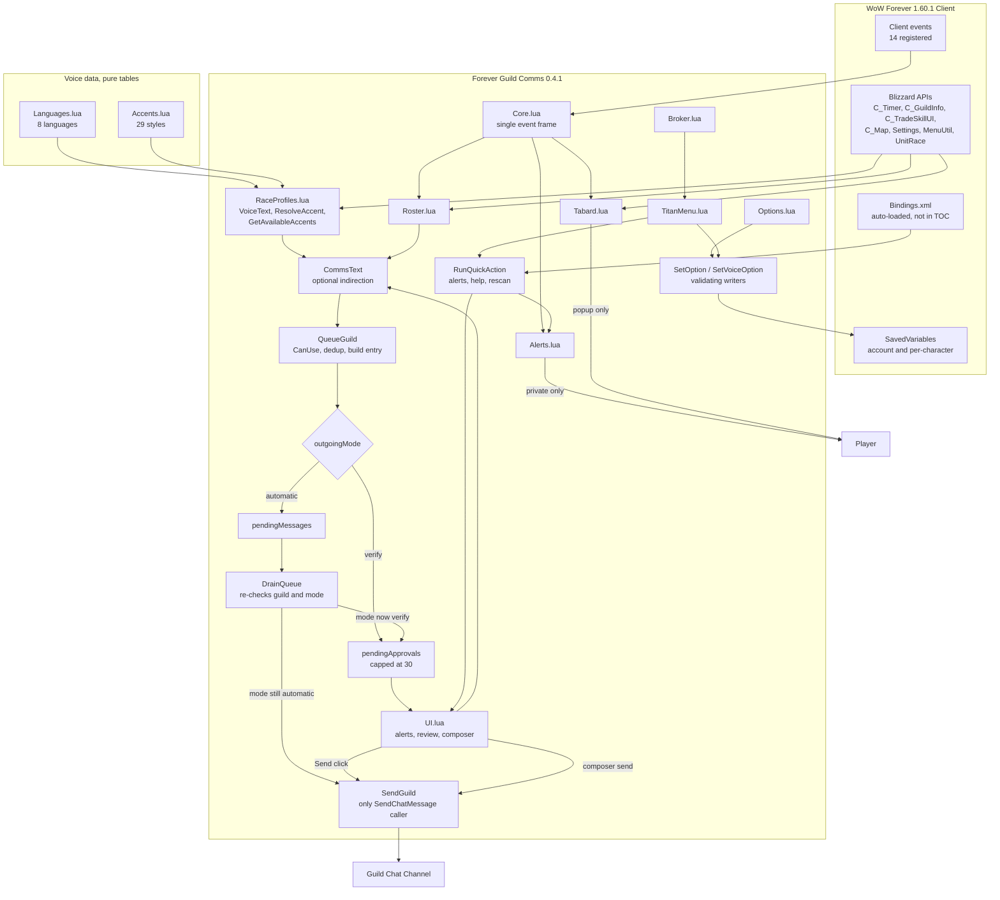
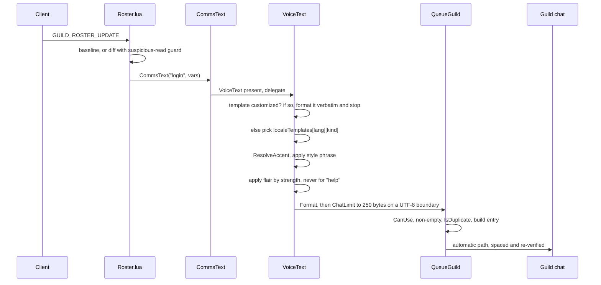
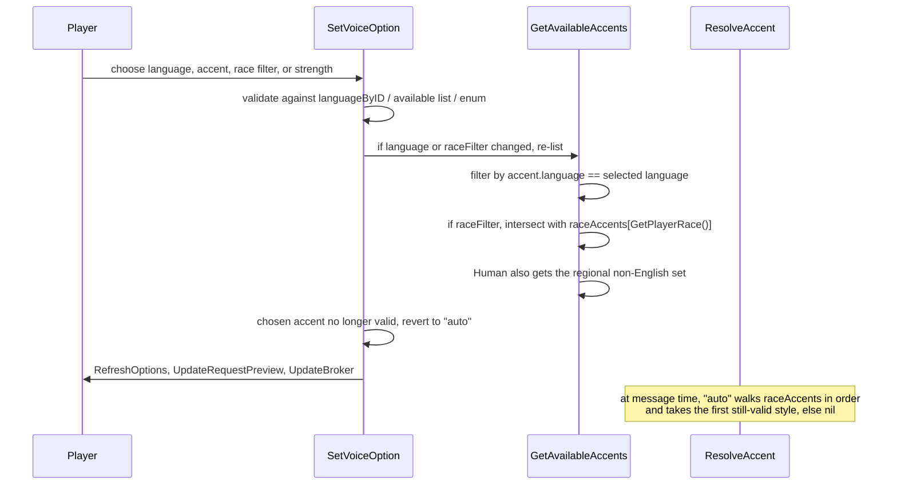
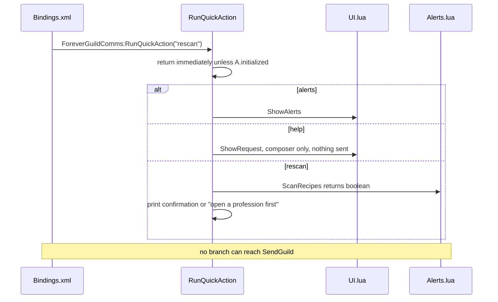
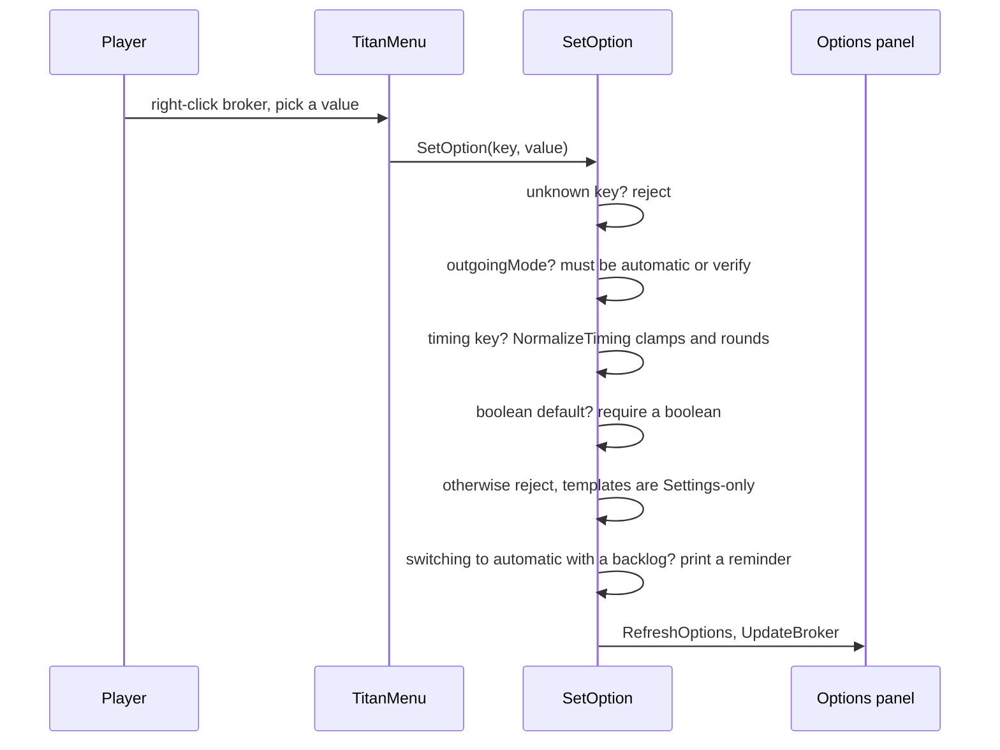

# System Architecture

**Analysis target**: Forever Guild Comms **0.4.3-beta**
**Supersedes**: the 0.4.1-beta pass of 2026-10-19T02:40:00Z

## System Overview

Forever Guild Comms is a single-package, in-process World of Warcraft addon written in
plain Lua 5.1. It has no build step, no server component, no network calls of its own, and
no data store beyond the client's SavedVariables files. It runs entirely inside the WoW
Forever 1.60.1 client process and is driven by client events plus user input.

The architecture remains a **shared-namespace module set with a single event dispatcher**.
Twelve source files are loaded in a fixed order declared by the TOC, each attaching
behaviour to one shared table `A`, published once as `_G.ForeverGuildComms`. A thirteenth
shipped file, `Bindings.xml`, is loaded automatically by the client from the addon root and
must *not* appear in the TOC.

Globals created: `_G.ForeverGuildComms`, the two `SLASH_*` variables and the `SlashCmdList`
entry, four named frames, two `StaticPopupDialogs` keys, and four `BINDING_*` label
globals.

Five architectural decisions now dominate:

1. **One event frame.** Still exactly one `CreateFrame("Frame")` dispatcher at the bottom
   of `Core.lua`, still 14 registered events. Three releases of features added none,
   because each is driven by existing events or by user input.
2. **One outbound chat path.** Everything terminates at `A:SendGuild`, the only caller of
   `SendChatMessage`.
3. **Mode-switched delivery.** `A.db.outgoingMode` is re-read inside the drain timer, so a
   mid-flight mode change captures a message rather than posting it.
4. **One validating setter per scope** *(new in 0.3.0/0.4.0)*. `A:SetOption` for
   account settings and `A:SetVoiceOption` for per-character voice settings. Both the
   Settings panel and the Titan menu write only through these, which is what keeps two
   independent UIs from disagreeing and guarantees clamping regardless of entry point.
5. **An optional presentation layer in front of message text** *(new in 0.4.0, extended in
   0.4.2)*. `A:CommsText` delegates to `A:VoiceText` when the voice modules are loaded and
   falls back to plain `A:Format` when they are not, so the four data modules are genuinely
   removable. 0.4.2 slotted variant selection into the same chain behind a second
   existence check (`if ... self.ChooseMessageTemplate`), so `MessageVariants.lua` is
   independently removable too.
6. **Bounded transient state** *(new in 0.4.3)*. The one unbounded structure in the addon,
   the `A.eventsSeen` dedup cache, is now swept on a 60-second activity throttle plus a
   300-second idle ticker, retaining entries for the longest supported cooldown rather
   than the configured one.

## The message text pipeline

Before any of the routes below, message text passes through a four-stage chain, each stage
optional and guarded:

```
A:CommsText(kind, vars, preview)
    |
    +-- no VoiceText loaded? -> A:Format(db.templates[kind], vars)   [end]
    |
    v
A:VoiceText(kind, vars, preview)
    |
    1. CUSTOM TEMPLATE CHECK
       stored template differs from shipped default?
       -> Format it verbatim and RETURN. No translation, no accent, no variant.
    |
    2. LANGUAGE
       text = localeTemplates[language][kind]
    |
    3. ACCENT
       accent resolved? text = accent.text[kind]
    |
    4. VARIANT  (0.4.2, skipped when preview=true or randomizeMessages off)
       text = ChooseMessageTemplate(kind, language, accent, text)
       -> shuffle bag over {base} plus curated alternatives
    |
    5. FLAIR  (applied after variant selection, never for kind == "help")
       moderate: prefix accent.flair
       expressive: prefix flair, then intensify terminal punctuation
    |
    v
A:Format -> A:ChatLimit (250 bytes, UTF-8 boundary safe)
```

Stage 1 is the load-bearing safety rule: a human-authored template short-circuits
everything downstream. Stage 4 sits deliberately *before* stage 5 so flair prefixes
whichever wording was drawn.

## The four routes to guild chat

Unchanged in count since 0.2.0. The text flowing through them is now produced by the
pipeline above.

```
Route 1 - AUTOMATIC (roster-driven, unattended)
    CommsText -> QueueGuild -> pendingMessages -> DrainQueue -> SendGuild
    Gates: CanUse, feature toggle, IsSelf, IsDuplicate, spacing,
           and at fire time: CanUse again, guild match, mode re-check

Route 2 - VERIFY (roster-driven, human in the loop)
    CommsText -> QueueGuild -> StageApproval -> pendingApprovals
              -> [human clicks Send] -> ApproveMessage -> SendGuild
    Gates: CanUse, feature toggle, IsSelf, IsDuplicate,
           and at click time: CanUse again, guild match, explicit click

Route 3 - EXPLICIT USER REQUEST
    [human clicks Send to Guild] -> SendHelpRequest -> SendGuild
    Gates: CanUse, non-empty activity, 20-second self-imposed rate limit
    0.4.2: the text comes from A.requestDraft, a fingerprinted cache, so the
    message sent is byte-identical to the preview the user approved

Route 4 - MID-FLIGHT CAPTURE
    Route 1 enqueued, then mode switched to verify
    -> drain timer stages the entry instead of sending it
```

Three input surfaces now feed the private, non-sending actions: slash commands, the Titan
nested menu, and key bindings. All three converge on `A:RunQuickAction`, which cannot
reach `SendGuild`.

## Architecture Diagram



### Text Alternative

```
Client events (14) -> Core.lua single event frame
                        -> Roster.lua -> CommsText -> QueueGuild
                        -> Alerts.lua (private only)
                        -> Tabard.lua (popup only)

Languages.lua + Accents.lua (pure data)
        -> RaceProfiles.lua (VoiceText)
        -> CommsText  [falls back to Format if voice modules absent]
        -> QueueGuild

QueueGuild -> outgoingMode?
                automatic -> pendingMessages -> DrainQueue -> SendGuild
                verify    -> pendingApprovals -> Review window
                                                 Send -> SendGuild
                                                 Dismiss -> discarded

Input surfaces for non-sending actions:
    slash commands  -+
    Titan menu      -+-> RunQuickAction -> alerts | help composer | rescan
    Bindings.xml    -+

Configuration writers:
    Options.lua  -+-> SetOption / SetVoiceOption -> SavedVariables
    TitanMenu    -+
```

## Component Descriptions

### Core.lua (476 lines, +170 since 0.2.0)
- **Purpose**: Foundation, send pipeline, approval backlog, validating setters, command and
  event surface.
- **New in this span**: `A:ChatLimit` (UTF-8-safe 250-byte truncation); `A:CommsText` (the
  voice indirection); `A.timingLimits` and `A:NormalizeTiming`; `A:RefreshOptions`;
  `A:SetOption`; `A:VoiceOptionLabel`, `A:SetVoiceOption`, `A:VoiceChoices`;
  `A:RunQuickAction`; the four `BINDING_*` globals; `A.voiceDefaults`; a section parameter
  on `A:OpenSettings` for deep linking; timing and voice migration in `A:Initialize`.
  Removed: the dead `A.lastMessages` table.
- **Dependencies**: Blizzard globals only. All cross-module calls remain guarded.
- **Type**: Application (foundation)

### Languages.lua (81 lines, new in 0.4.0)
- **Purpose**: Offline translation data for the four built-in templates.
- **Responsibilities**: `A.languages` (8 entries), `A.languageByID`, `A.localeTemplates`,
  `A.localeRoleNames`, `A.localeActivityTypes`. Zero methods.
- **Dependencies**: reads `A.defaults.templates` for the English entry, so it must load
  after `Core.lua`.
- **Type**: Application (data)

### Accents.lua (51 lines, new in 0.4.0)
- **Purpose**: Curated style data.
- **Responsibilities**: `A.accents` populated by a file-local `register` helper, and
  `A.accentOrder` for stable ordering. 29 styles: 21 bound to English (8 regional human,
  13 WoW-race RP), 3 Spanish, 1 French, 1 German, 2 Portuguese, 1 Italian. Zero methods.
- **Type**: Application (data)

### MessageVariants.lua (229 lines, new in 0.4.2)
- **Purpose**: Additional curated phrasings plus the selection algorithm.
- **Responsibilities**: `A.localeVariants` (68 alternatives across all 8 languages),
  `A.accentVariants` (136 across all 29 accents), `A.messageVariantBags` for session-local
  state, and `A:ChooseMessageTemplate`. The selector builds the candidate list from the
  base template plus any non-empty, non-duplicate additions, returns the base unchanged if
  fewer than two candidates exist, keys its bag by `kind:language:accentId`, reshuffles
  with a Fisher-Yates pass on exhaustion or on a candidate-count change, and swaps the new
  bag's first entry if it would repeat the previous bag's last pick.
- **Dependencies**: reads nothing from the other data modules; receives the base template
  and the resolved accent as arguments, which keeps it decoupled.
- **Type**: Application (data + selection)

### RaceProfiles.lua (102 lines, new in 0.4.0)
- **Purpose**: The voice layer's logic.
- **Responsibilities**: `A.raceAccents`; `A:GetPlayerRace`; `A:GetAvailableAccents`;
  `A:ResolveAccent`; `A:VoiceText`; `A:LocalizeRoleText`; `A:LocalizeActivityType`.
- **Dependencies**: `Languages.lua` and `Accents.lua` data, `A.char.voice`, `UnitRace`.
- **Type**: Application (feature)

### Roster.lua (123 lines, +0)
- **Purpose**: Convert roster state changes into the three public events.
- **Change**: the three message sites call `A:CommsText` rather than `A:Format`. Diff
  logic, baseline behaviour, throttles, and the guild-change reset are untouched.
- **Type**: Application (feature)

### Alerts.lua (99 lines, +1)
- **Purpose**: Detect answerable requests; maintain the recipe cache.
- **Change**: `A:ScanRecipes` returns `true` on a successful scan and `false` on each early
  exit, so `RunQuickAction` can report the real outcome.
- **Type**: Application (feature)

### Tabard.lua (70 lines, +6)
- **Purpose**: Capital-city tabard reminder.
- **Change in 0.4.3**, its first since 0.1.0. `A:CheckTabard` was restructured to fix the
  ordering race recorded in all three prior passes. It now always records `wasInCity`
  rather than returning early on the first call; a `tabardInitialCheckDone` latch lets the
  3-second login check still prompt after the 1.2-second `PLAYER_ENTERING_WORLD` check has
  initialised the flag; and a `tabardCityPrompted` flag, cleared on leaving a city, allows
  at most one city prompt per uninterrupted stay. The exit branch now requires `before` to
  be truthy, so leaving cannot prompt before a city has been observed.
- **Type**: Application (feature)

### UI.lua (286 lines, +1)
- **Purpose**: The three windows.
- **Change**: `A:RequestText` computes a `custom` flag by comparing the help template
  against its default, then uses either raw or localized role and activity labels and
  routes through `CommsText`. The window and row machinery is otherwise unchanged.
- **Type**: Application (presentation)

### Options.lua (286 lines, +103)
- **Purpose**: The full Settings surface.
- **Change**: numeric timing fields with validation and Use default buttons; a Languages
  and accents section with language, accent, race filter, strength, and a live preview; an
  addon icon texture; `A.optionsPanel`, `A.optionsScroll`, `A.messagesScrollY`, and
  `A.languagesScrollY` published so the Titan menu can deep-link; `OnDefault` extended to
  reset per-character voice settings.
- **Type**: Application (presentation)

### TitanMenu.lua (127 lines, new in 0.3.0)
- **Purpose**: Nested right-click configuration.
- **Responsibilities**: `A:PopulateTitanMenu` builds the tree — enable toggle, outgoing
  messages (mode radios, the three event toggles, spacing and cooldown preset submenus
  with reset), private requests, languages and accents, tabard, quick actions, and
  Settings shortcuts. `A:OpenTitanMenu` creates the context menu through `MenuUtil`,
  printing a note and opening Settings when the client lacks it, and substituting
  `UIParent` when the LDB consumer passes a non-frame owner.
- **Dependencies**: `MenuUtil` (feature-detected), `A:SetOption`, `A:SetVoiceOption`,
  `A:RunQuickAction`, `A:OpenSettings`.
- **Type**: Application (presentation)

### Broker.lua (38 lines, +0)
- **Purpose**: Optional status indicator and the menu entry point.
- **Type**: Application (optional integration)

### Bindings.xml (12 lines, new in 0.4.1, shipped, not in TOC)
- **Purpose**: Three opt-in hotkeys in the `ADDONS` category under a
  `FOREVERGUILDCOMMS` header.
- **Responsibilities**: each binding body calls
  `ForeverGuildComms:RunQuickAction("<action>")` behind an `if ForeverGuildComms then`
  guard. No `default=` attribute anywhere.
- **Type**: Application (declarative input)

## Data Flow

### BT-1 with the voice layer engaged



### BT-11: resolving an accent



### BT-13: a hotkey press



### BT-12: a Titan menu write



## Event Routing Table

Unchanged across all three releases: 14 events, one frame. `PLAYER_LOGIN` and
`ADDON_LOADED` are handled before the `if not A.initialized then return end` gate.

| Event | Routed to | Guard |
| --- | --- | --- |
| `PLAYER_LOGIN` | `A:Initialize` | returns immediately after |
| `ADDON_LOADED` | `A:TryBroker` | only if already initialized |
| `CHAT_MSG_GUILD` | `A:OnGuildChat` | `if A.OnGuildChat` |
| `CHAT_MSG_SYSTEM` | `A:OnSystemGuildJoin` | `if A.OnSystemGuildJoin` |
| `UI_INFO_MESSAGE` | `A:OnSystemGuildJoin` via `select(2, ...)` | `if A.OnSystemGuildJoin` |
| `GUILD_ROSTER_UPDATE` | `A:OnRosterEvent` | `if A.OnRosterEvent` |
| `PLAYER_GUILD_UPDATE` | `A:OnRosterEvent` | `if A.OnRosterEvent` |
| `TRADE_SKILL_SHOW` | `A:ScheduleRecipeScan` | `if A.ScheduleRecipeScan` |
| `TRADE_SKILL_LIST_UPDATE` | `A:ScheduleRecipeScan` | `if A.ScheduleRecipeScan` |
| `NEW_RECIPE_LEARNED` | `A:ScheduleRecipeScan` | `if A.ScheduleRecipeScan` |
| `ZONE_CHANGED` | `A:ScheduleTabardCheck` | `if A.ScheduleTabardCheck` |
| `ZONE_CHANGED_NEW_AREA` | `A:ScheduleTabardCheck` | `if A.ScheduleTabardCheck` |
| `ZONE_CHANGED_INDOORS` | `A:ScheduleTabardCheck` | `if A.ScheduleTabardCheck` |
| `PLAYER_ENTERING_WORLD` | `A:ScheduleTabardCheck` | `if A.ScheduleTabardCheck` |

## Integration Points

- **External APIs**: none. No network calls. The only outbound channel is
  `SendChatMessage(..., "GUILD")`.
- **Databases**: none. `ForeverGuildCommsDB` (account, `A.db`) and
  `ForeverGuildCommsCharDB` (per character, `A.char`, now holding `voice` alongside
  `recipes`, `myRoles`, `needRoles`). `A.pendingApprovals` remains deliberately
  unpersisted.
- **Third-party Services**: LibDataBroker-1.1 via `LibStub`, supplied by Titan Panel.
  Still optional, still runtime-detected, still not embedded. Notably `TitanMenu.lua` does
  **not** add a Titan dependency: it uses Blizzard's own `MenuUtil`, so no Titan menu
  library is bundled.
- **Release pipeline** *(new)*: `.github/workflows/package.yml` publishes a ZIP through
  BigWigsMods/packager on a `v*` tag, using the built-in `GITHUB_TOKEN`. CurseForge,
  WoWInterface, and Wago tokens are optional secrets. `.pkgmeta` excludes `install/`,
  `tests/`, `PACKAGING.md`, `.github/`, and the promotional icon.

## Infrastructure Components

- **CDK Stacks**: none.
- **Deployment Model**: two paths now. A packaged ZIP extracted to
  `Interface\AddOns\ForeverGuildComms\`, or the integrated Windows installer
  (`install/Install-ForeverGuildComms.ps1`, 313 lines) which parses the TOC, validates
  each entry against `^[A-Za-z0-9_-]+\.(lua|xml)$`, appends `Media/Icon.tga` and
  `Bindings.xml` explicitly, skips identical files, backs up overwritten files to
  `Interface\AddOnBackups`, and leaves SavedVariables untouched.
- **CI**: GitHub Actions, tag-triggered packaging only. No test execution in CI.
- **Networking**: none at runtime.

## Cross-Cutting Concerns

| Concern | Mechanism | Location |
| --- | --- | --- |
| **Preview/send fidelity** *(new in 0.4.2)* | `A.requestDraft` caches the composed help request behind a fingerprint over the template, randomize flag, four voice settings, and five interpolated values; cleared on reopen and after a send | `UI.lua` |
| **Bounded transient state** *(new in 0.4.3)* | `A:PruneEventsSeen`, activity-throttled to 60s plus a 300s idle ticker, retaining the longest supported cooldown window and discarding malformed or future timestamps | `Core.lua` |
| **One prompt per city stay** *(new in 0.4.3)* | `A.tabardCityPrompted` set on prompt, cleared on leaving; `A.tabardInitialCheckDone` keeps the login check effective regardless of event order | `Tabard.lua` |
| Authorization to act | `A:CanUse`, re-checked at drain and approval time | `Core.lua` |
| Human confirmation | `outgoingMode == "verify"` stages; the Send click schedules nothing | `Core.lua`, `UI.lua` |
| Guild identity binding | Each entry records its guild; mismatches discarded at both delivery points | `Core.lua` |
| Duplicate suppression | `A:IsDuplicate` over `A.eventsSeen` | `Core.lua` |
| Rate limiting | Drain spacing; 20s manual request; 30s roster throttle; 60s ticker. Approvals intentionally unspaced | `Core.lua`, `UI.lua`, `Roster.lua` |
| **Settings validation** *(new)* | `A:SetOption` and `A:SetVoiceOption` are the only writers; both reject out-of-domain values and clamp timing | `Core.lua` |
| **UI synchronisation** *(new)* | `A:RefreshOptions` replays the Settings control closures after any write from any surface | `Core.lua`, `Options.lua` |
| **Byte-safe truncation** *(new)* | `A:ChatLimit` walks back off UTF-8 continuation bytes before cutting at 250 | `Core.lua` |
| **Optional feature layering** *(new)* | `A:CommsText` falls back to `A:Format` when the voice modules are absent | `Core.lua` |
| **Customized text protection** *(new)* | `A:VoiceText` returns the player's template verbatim when it differs from the default | `RaceProfiles.lua` |
| Self-exclusion | `A:IsSelf` by GUID then normalized name then de-realmed name | `Core.lua` |
| Error containment | `pcall` around `SendChatMessage`, reported via `A:Print` | `Core.lua` |
| API volatility | Feature detection before every Blizzard call, including `MenuUtil` and `UnitRace` | all modules |
| Setting normalization | Mode coerced to a known value; blank templates refilled; timing clamped; invalid voice reverted to `auto` | `Core.lua` `A:Initialize` |
| Deferred work | `C_Timer.After` plus a boolean latch; one `C_Timer.NewTicker` | `Roster.lua`, `Alerts.lua`, `Tabard.lua`, `Core.lua` |
| Observability | `A:Print` with a coloured tag; `/fgc status`; broker label and tooltip | `Core.lua`, `Broker.lua` |
