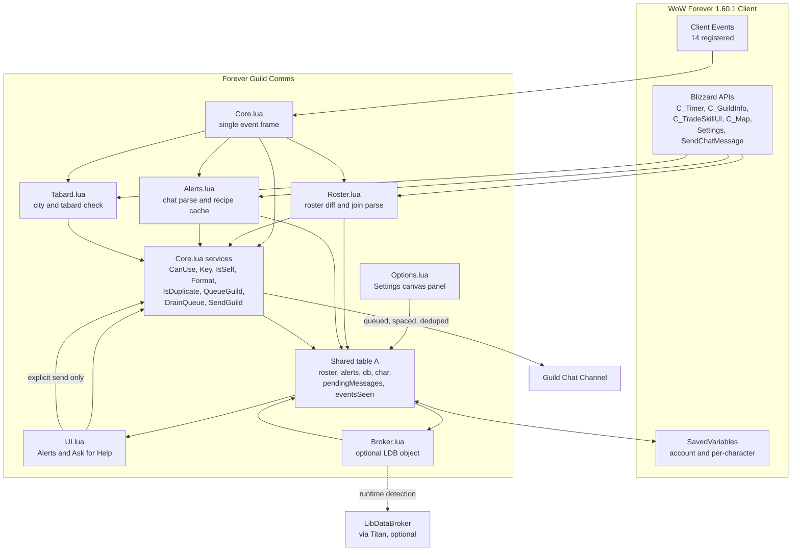
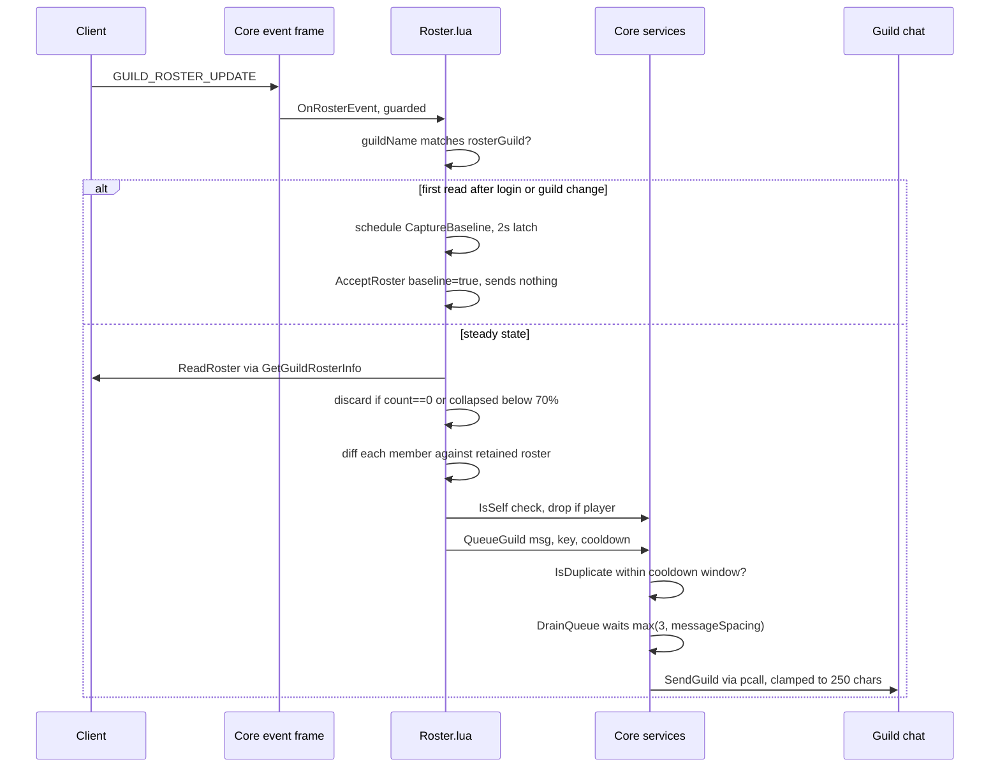
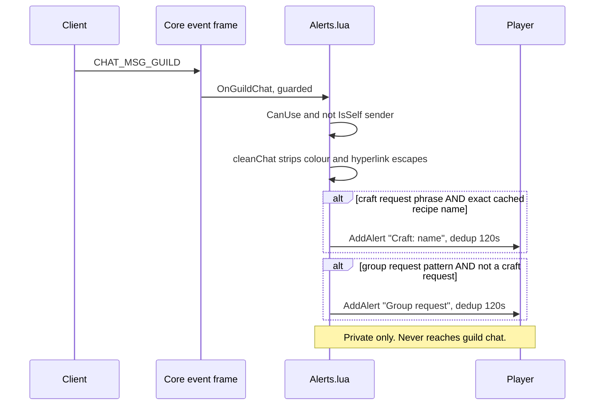
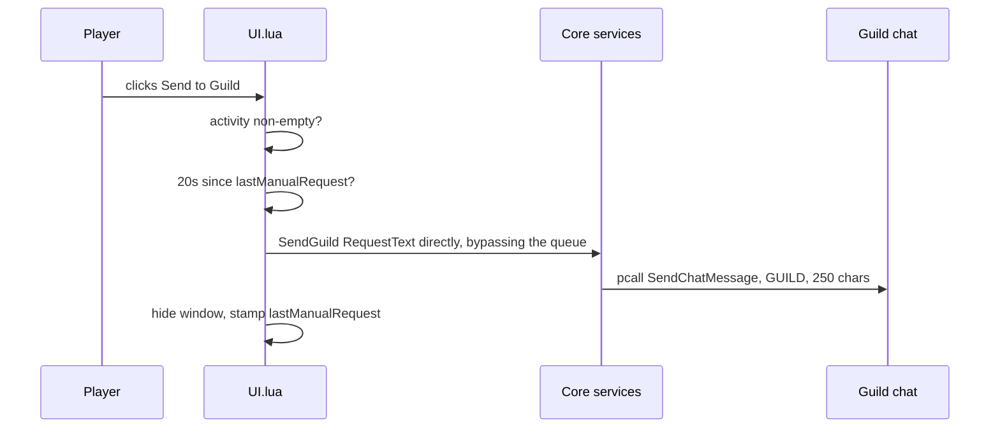

# System Architecture

## System Overview

Forever Guild Comms is a single-package, in-process World of Warcraft addon written in
plain Lua 5.1. It has no build step, no server component, no network calls of its own,
and no data store beyond the client's SavedVariables files. It runs entirely inside the
WoW Forever 1.60.1 client process and is driven exclusively by client events.

The architecture is a **shared-namespace module set with a single event dispatcher**.
Seven source files are loaded in a fixed order declared by the TOC. Each file receives
the addon vararg and attaches its behavior to one shared table, conventionally named `A`:

```lua
local _, A = ...        -- Core.lua uses: local ADDON, A = ...
```

`Core.lua` publishes that table once as `_G.ForeverGuildComms`. No other globals are
created except the `SLASH_*` / `SlashCmdList` entries, three named frames, and two
`StaticPopupDialogs` keys.

Two architectural decisions dominate everything else:

1. **One event frame.** Exactly one `CreateFrame("Frame")` dispatcher exists, at the
   bottom of `Core.lua`. It registers 14 events and routes each to a guarded module
   method. Feature files never create their own event frames.
2. **One outbound chat path.** All automatic guild messages funnel through
   `A:QueueGuild` into `A:DrainQueue` and only then to `A:SendGuild`. The sole exception
   is the explicit user button press in `A:SendHelpRequest`, which calls `A:SendGuild`
   directly and carries its own 20-second rate limit.

Because later modules are optional from `Core.lua`'s point of view, every cross-file call
is made through an existence check, which makes the module set degrade rather than error
if a file is missing or fails to load:

```lua
if self.BuildUI then self:BuildUI() end
if A.OnGuildChat then A:OnGuildChat(...) end
```

## Architecture Diagram



### Text Alternative

```
Client events (14)
    |
    v
Core.lua single event frame
    |
    +--> Roster.lua  --+
    +--> Alerts.lua  --+--> Core.lua services --> guild chat
    +--> Tabard.lua  --+     (CanUse, IsSelf, IsDuplicate,
    |                        QueueGuild, DrainQueue, SendGuild)
    v
shared table A  <--> SavedVariables
    |
    +--> UI.lua       (reads state, explicit send only)
    +--> Options.lua  (writes settings)
    +--> Broker.lua   (reads counts, optional LibDataBroker)
```

## Component Descriptions

### Core.lua
- **Purpose**: Shared namespace, settings, send pipeline, command surface, event dispatch.
- **Responsibilities**: Publish `_G.ForeverGuildComms`; declare `A.defaults` and
  `A.classRoles`; backfill SavedVariables via `fillDefaults`; provide `Print`, `Key`,
  `IsSelf`, `Format`, `CanUse`, `Now`, `IsDuplicate`, `RoleText`, `OpenSettings`;
  own `SendGuild`, `QueueGuild`, `DrainQueue`; run `A:Initialize`; register
  `/fgc` and `/guildcomms`; host the one event frame.
- **Dependencies**: Blizzard globals only. Calls into later modules strictly through
  existence checks.
- **Type**: Application (foundation)

### Roster.lua
- **Purpose**: Convert roster state changes into the three public social messages.
- **Responsibilities**: `RequestRoster` with a 30-second throttle; `ReadRoster`;
  `AcceptRoster` (the diff); `CaptureBaseline`; `OnRosterEvent`; `OnSystemGuildJoin`;
  `SetupRoster` with a 60-second ticker.
- **Dependencies**: `Core.lua` (`Key`, `IsSelf`, `Format`, `CanUse`, `Now`, `QueueGuild`);
  `GetNumGuildMembers`, `GetGuildRosterInfo`, `GetGuildInfo`, `IsInGuild`,
  `C_GuildInfo.GuildRoster`, `ERR_GUILD_JOIN_S`, `C_Timer`. Optionally calls
  `UpdateBroker`.
- **Type**: Application (feature)

### Alerts.lua
- **Purpose**: Detect answerable requests in guild chat and maintain the recipe cache.
- **Responsibilities**: `cleanChat`, `looksLikeCraftRequest`, `looksLikeGroupRequest`
  (file-local); `AddAlert` with 120-second dedup and a 30-entry cap;
  `ScheduleRecipeScan` and `ScanRecipes`; `MatchCraft`; `OnGuildChat`.
- **Dependencies**: `Core.lua` (`Key`, `IsSelf`, `CanUse`, `IsDuplicate`, `Print`);
  `C_TradeSkillUI`, `C_Timer`, `PlaySound`, `SOUNDKIT`, `date`. Optionally calls
  `UpdateAlertsUI` and `UpdateBroker`.
- **Type**: Application (feature)

### Tabard.lua
- **Purpose**: Capital-city guild tabard courtesy reminder.
- **Responsibilities**: `citiesByName` and `citiesByMapID` tables; `inMajorCity` and
  `guildTabardEquipped` (file-local); the `FGC_TABARD_CITY` and `FGC_TABARD_EXIT` popups;
  `CheckTabard`; `ScheduleTabardCheck` with a 1.2-second debounce.
- **Dependencies**: `Core.lua` (`CanUse`); `C_Map.GetBestMapForUnit`, `GetRealZoneText`,
  `GetInventoryItemID`, `StaticPopup_Show`, `ToggleCharacter`, `C_Timer`.
- **Type**: Application (feature)

### UI.lua
- **Purpose**: The two player-facing windows.
- **Responsibilities**: `Label`, `Button`, `Check` (file-local widget factories);
  `BuildUI` creating `FGCAlertsFrame` with seven reusable rows and paging;
  `UpdateAlertsUI`; `ShowAlerts`; `BuildRequestUI` creating `FGCRequestFrame`;
  `RequestText`; `UpdateRequestPreview`; `ShowRequest`; `SendHelpRequest`.
- **Dependencies**: `Core.lua` (`Format`, `RoleText`, `CanUse`, `SendGuild`, `Now`,
  `Print`); `CreateFrame`, `BasicFrameTemplateWithInset`, `UIPanelButtonTemplate`,
  `UICheckButtonTemplate`, `InputBoxTemplate`, `ChatFrame_OpenChat`.
- **Type**: Application (presentation)

### Options.lua
- **Purpose**: Settings panel for every toggle and template.
- **Responsibilities**: `MakeLabel`, `MakeButton` (file-local); `BuildOptions` creating
  `ForeverGuildCommsOptionsPanel` inside a scroll frame, with section, toggle, and
  template builders, plus `OnRefresh`, `OnCommit`, `OnDefault`; registers the canvas
  category.
- **Dependencies**: `Settings.RegisterCanvasLayoutCategory`,
  `Settings.RegisterAddOnCategory`, `CreateFrame`; `A.db`, `A.defaults`. Degrades with a
  printed note if the modern Settings API is missing.
- **Type**: Application (presentation)

### Broker.lua
- **Purpose**: Optional status indicator.
- **Responsibilities**: `TryBroker` detecting `LibStub("LibDataBroker-1.1", true)` and
  publishing the `ForeverGuildComms` data object with click and tooltip handlers;
  `UpdateBroker` refreshing the label text.
- **Dependencies**: `LibStub` (optional, runtime-detected); `A.onlineCount`,
  `A.guildCount`, `A.alerts`.
- **Type**: Application (optional integration)

### tests/smoke.lua
- **Purpose**: Offline logic harness. Not listed in the TOC and not shipped.
- **Responsibilities**: Stub client globals, `loadfile` the three testable modules,
  assert the safety invariants, print `PASSED`.
- **Dependencies**: A standalone Lua 5.1 interpreter.
- **Type**: Test

## Data Flow

### BT-1 and BT-3: roster-driven public messages



### BT-4 and BT-5: chat-driven private alerts



### BT-7: the one explicit public send



## Event Routing Table

All 14 events are registered on the single frame in `Core.lua`. `PLAYER_LOGIN` and
`ADDON_LOADED` are handled before the `if not A.initialized then return end` gate; every
other event is handled after it.

| Event | Routed to | Guard |
| --- | --- | --- |
| `PLAYER_LOGIN` | `A:Initialize` | returns immediately after |
| `ADDON_LOADED` | `A:TryBroker` | only if already initialized |
| `CHAT_MSG_GUILD` | `A:OnGuildChat` | `if A.OnGuildChat` |
| `CHAT_MSG_SYSTEM` | `A:OnSystemGuildJoin` | `if A.OnSystemGuildJoin` |
| `UI_INFO_MESSAGE` | `A:OnSystemGuildJoin` via `select(2, ...)` | `if A.OnSystemGuildJoin` |
| `GUILD_ROSTER_UPDATE` | `A:OnRosterEvent` | `if A.OnRosterEvent` |
| `PLAYER_GUILD_UPDATE` | `A:OnRosterEvent` | `if A.OnRosterEvent` |
| `TRADE_SKILL_SHOW` | `A:ScheduleRecipeScan` | `if A.ScheduleRecipeScan` |
| `TRADE_SKILL_LIST_UPDATE` | `A:ScheduleRecipeScan` | `if A.ScheduleRecipeScan` |
| `NEW_RECIPE_LEARNED` | `A:ScheduleRecipeScan` | `if A.ScheduleRecipeScan` |
| `ZONE_CHANGED` | `A:ScheduleTabardCheck` | `if A.ScheduleTabardCheck` |
| `ZONE_CHANGED_NEW_AREA` | `A:ScheduleTabardCheck` | `if A.ScheduleTabardCheck` |
| `ZONE_CHANGED_INDOORS` | `A:ScheduleTabardCheck` | `if A.ScheduleTabardCheck` |
| `PLAYER_ENTERING_WORLD` | `A:ScheduleTabardCheck` | `if A.ScheduleTabardCheck` |

## Integration Points

- **External APIs**: None. The addon makes no network calls. Its only outbound channel is
  `SendChatMessage(..., "GUILD")`.
- **Databases**: None. Persistence is the client's SavedVariables mechanism:
  `ForeverGuildCommsDB` (account-wide, accessed as `A.db`) and `ForeverGuildCommsCharDB`
  (per character, accessed as `A.char`, holding `recipes`, `myRoles`, `needRoles`).
- **Third-party Services**: LibDataBroker-1.1, reached through `LibStub` and supplied in
  practice by Titan Panel. Declared `## OptionalDeps: Titan`, never a required
  dependency, and detected at runtime with the silent-failure form
  `LibStub("LibDataBroker-1.1", true)`.

## Infrastructure Components

- **CDK Stacks**: None. This is a client-side addon with no cloud footprint.
- **Deployment Model**: File copy. The packaged zip extracts to
  `World of Warcraft\_classic_beta_\Interface\AddOns\ForeverGuildComms\`, and the client
  loads `ForeverGuildComms.toc` at startup or `/reload`. The inner folder name must match
  the TOC filename exactly.
- **Networking**: None.

## Cross-Cutting Concerns

| Concern | Mechanism | Location |
| --- | --- | --- |
| Authorization to act | `A:CanUse` requires the enabled flag and `IsInGuild()` | `Core.lua`, checked by every guild-facing path |
| Duplicate suppression | `A:IsDuplicate(key, cooldown)` over `A.eventsSeen` | `Core.lua`, applied inside `QueueGuild` and `AddAlert` |
| Rate limiting | `DrainQueue` spacing; 20s manual-request limit; 30s roster throttle; 60s ticker | `Core.lua`, `UI.lua`, `Roster.lua` |
| Self-exclusion | `A:IsSelf` by GUID then normalized name then de-realmed name | `Core.lua`, applied in `AcceptRoster`, `OnSystemGuildJoin`, `OnGuildChat` |
| Error containment | `pcall` around `SendChatMessage`, reported through `A:Print` | `Core.lua` |
| API volatility | Feature detection before every Blizzard call | all modules |
| Input clamping | 250-character clamp in `Format` and again in `SendGuild`; `SetMaxLetters` on edit boxes | `Core.lua`, `UI.lua`, `Options.lua` |
| Deferred work | `C_Timer.After` plus a boolean latch; one `C_Timer.NewTicker` | `Roster.lua`, `Alerts.lua`, `Tabard.lua`, `Core.lua` |
| Observability | `A:Print` with a coloured addon tag; `/fgc status` | `Core.lua` |
