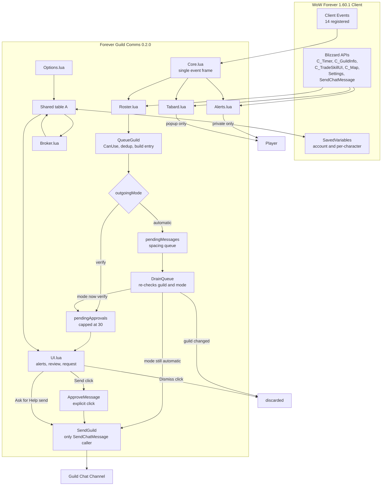
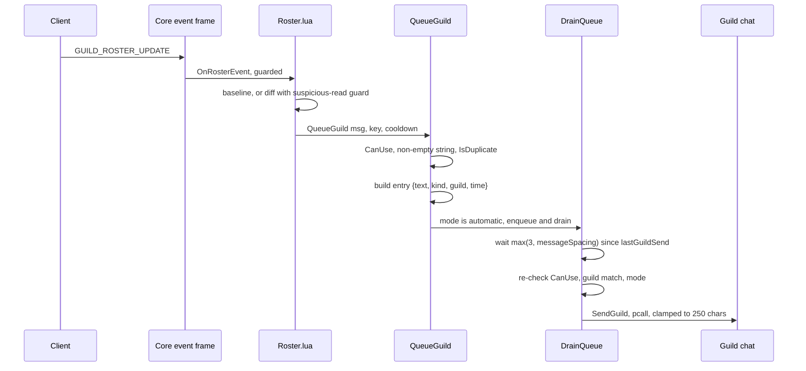
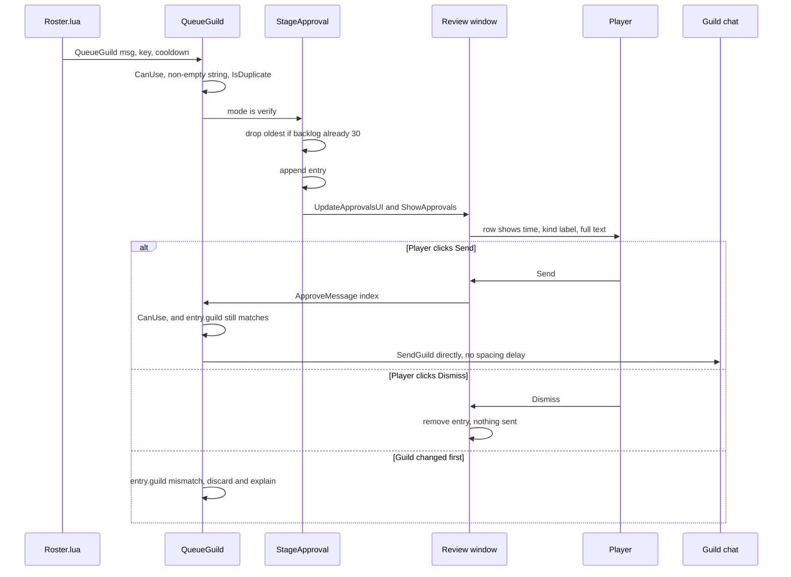
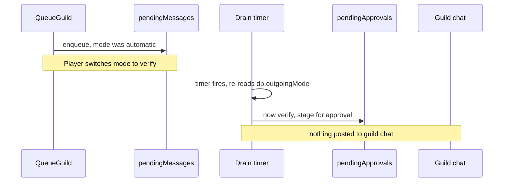
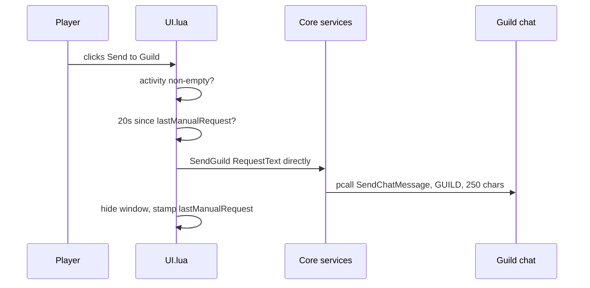

# System Architecture

**Analysis target**: Forever Guild Comms **0.2.0-beta**
**Supersedes**: the 0.1.0-beta pass of 2026-10-18

## System Overview

Forever Guild Comms is a single-package, in-process World of Warcraft addon written in
plain Lua 5.1. It has no build step, no server component, no network calls of its own,
and no data store beyond the client's SavedVariables files. It runs entirely inside the
WoW Forever 1.60.1 client process and is driven exclusively by client events.

The architecture is a **shared-namespace module set with a single event dispatcher**.
Seven source files are loaded in a fixed order declared by the TOC. Each file receives
the addon vararg and attaches its behavior to one shared table, conventionally named `A`:

```lua
local _, A = ...        -- Core.lua uses: local ADDON, A = ...
```

`Core.lua` publishes that table once as `_G.ForeverGuildComms`. No other globals are
created except the `SLASH_*` / `SlashCmdList` entries, four named frames, and two
`StaticPopupDialogs` keys.

Three architectural decisions dominate everything else:

1. **One event frame.** Exactly one `CreateFrame("Frame")` dispatcher exists, at the
   bottom of `Core.lua`. It registers 14 events and routes each to a guarded module
   method. Feature files never create their own event frames. Unchanged in 0.2.0.
2. **One outbound chat path.** Every message still terminates at `A:SendGuild`, the only
   caller of `SendChatMessage`. What changed in 0.2.0 is that there are now **three**
   routes into it rather than two.
3. **Mode-switched delivery.** `A.db.outgoingMode` selects, at the moment of delivery
   rather than at the moment of composition, whether a roster-driven message is posted
   automatically or staged for human approval. The mode is re-read inside the drain timer,
   which is what makes a mid-flight mode change capture a message instead of posting it.

Because later modules are optional from `Core.lua`'s point of view, every cross-file call
is made through an existence check, which makes the module set degrade rather than error
if a file is missing or fails to load:

```lua
if self.BuildUI then self:BuildUI() end
if A.OnGuildChat then A:OnGuildChat(...) end
if self.ClearApprovals then self:ClearApprovals() end
```

## The three routes to guild chat

This is the most important structural change in 0.2.0 and the thing any future change
must not disturb.

```
Route 1 - AUTOMATIC (roster-driven, unattended)
    QueueGuild -> pendingMessages -> DrainQueue -> SendGuild
    Gates: CanUse, feature toggle, IsSelf, IsDuplicate, spacing,
           and at fire time: CanUse again, guild match, mode re-check

Route 2 - VERIFY (roster-driven, human in the loop)
    QueueGuild -> StageApproval -> pendingApprovals -> [human clicks Send]
               -> ApproveMessage -> SendGuild
    Gates: CanUse, feature toggle, IsSelf, IsDuplicate,
           and at click time: CanUse again, guild match, explicit click
    No spacing delay. The click is the confirmation.

Route 3 - EXPLICIT USER REQUEST (unchanged from 0.1.0)
    [human clicks Send to Guild] -> SendHelpRequest -> SendGuild
    Gates: CanUse, non-empty activity, 20-second self-imposed rate limit
    Bypasses the queue by design.
```

A message can also move from Route 1 to Route 2 after it has been queued: if the player
switches to Verify while a message is still waiting in the spacing queue, the drain timer
stages it instead of sending it.

## Architecture Diagram



### Text Alternative

```
Client events (14) -> Core.lua single event frame
                          |
         +----------------+----------------+
         v                v                v
    Roster.lua       Alerts.lua       Tabard.lua
         |                |                |
         v                v                v
    QueueGuild      private alert    private popup
         |           (never public)   (never public)
         v
    outgoingMode?
      |        |
 automatic   verify
      |        |
      v        v
 pendingMessages   pendingApprovals (cap 30)
      |                  |
      v                  v
  DrainQueue        Review window
  re-checks:        Send click -> ApproveMessage
   - CanUse         Dismiss click -> discarded
   - guild match
   - mode again
      |                  |
      +--------+---------+
               v
          SendGuild  <-- also reached directly by
               |          SendHelpRequest (explicit)
               v
        Guild Chat Channel
```

## Component Descriptions

### Core.lua
- **Purpose**: Shared namespace, settings, send pipeline, approval backlog, command
  surface, event dispatch.
- **Responsibilities**: Publish `_G.ForeverGuildComms`; declare `A.defaults` and
  `A.classRoles`; backfill SavedVariables via `fillDefaults` plus the 0.2.0 mode and
  template migrations; provide `Print`, `Key`, `IsSelf`, `Format`, `CanUse`, `Now`,
  `IsDuplicate`, `RoleText`, `OpenSettings`; own `SendGuild`, `QueueGuild`, `DrainQueue`,
  `StageApproval`, `ApproveMessage`, `DismissMessage`, `ClearApprovals`; run
  `A:Initialize`; register `/fgc` and `/guildcomms`; host the one event frame.
- **Dependencies**: Blizzard globals only. Calls into later modules strictly through
  existence checks.
- **Type**: Application (foundation)
- **0.2.0 delta**: +99 lines. Four new methods, one new state table, one new setting,
  two new migrations, a rewritten `QueueGuild` and `DrainQueue`, two new slash
  subcommands, and an expanded `/fgc status`.

### Roster.lua
- **Purpose**: Convert roster state changes into the three public social messages.
- **Responsibilities**: `RequestRoster` with a 30-second throttle; `ReadRoster`;
  `AcceptRoster` (the diff); `CaptureBaseline`; `OnRosterEvent`; `OnSystemGuildJoin`;
  `SetupRoster` with a 60-second ticker.
- **Dependencies**: `Core.lua` (`Key`, `IsSelf`, `Format`, `CanUse`, `Now`,
  `QueueGuild`, `ClearApprovals`); the guild roster and guild-info globals;
  `ERR_GUILD_JOIN_S`; `C_Timer`. Optionally calls `UpdateBroker`.
- **Type**: Application (feature)
- **0.2.0 delta**: +1 line. The guild-change branch now also calls `ClearApprovals`
  through an existence check, so the approval backlog cannot survive into a new guild.

### Alerts.lua
- **Purpose**: Detect answerable requests in guild chat and maintain the recipe cache.
- **Responsibilities**: `cleanChat`, `looksLikeCraftRequest`, `looksLikeGroupRequest`
  (file-local); `AddAlert` with 120-second dedup and a 30-entry cap;
  `ScheduleRecipeScan` and `ScanRecipes`; `MatchCraft`; `OnGuildChat`.
- **Dependencies**: `Core.lua` (`Key`, `IsSelf`, `CanUse`, `IsDuplicate`, `Print`);
  `C_TradeSkillUI`, `C_Timer`, `PlaySound`, `SOUNDKIT`, `date`. Optionally calls
  `UpdateAlertsUI` and `UpdateBroker`.
- **Type**: Application (feature)
- **0.2.0 delta**: none. Alerts were already private, so the new mode does not apply to
  them.

### Tabard.lua
- **Purpose**: Capital-city guild tabard courtesy reminder.
- **Responsibilities**: `citiesByName` and `citiesByMapID` tables; `inMajorCity` and
  `guildTabardEquipped` (file-local); the `FGC_TABARD_CITY` and `FGC_TABARD_EXIT` popups;
  `CheckTabard`; `ScheduleTabardCheck` with a 1.2-second debounce.
- **Dependencies**: `Core.lua` (`CanUse`); `C_Map.GetBestMapForUnit`, `GetRealZoneText`,
  `GetInventoryItemID`, `StaticPopup_Show`, `ToggleCharacter`, `C_Timer`.
- **Type**: Application (feature)
- **0.2.0 delta**: none.

### UI.lua
- **Purpose**: The player's three windows.
- **Responsibilities**: `Label`, `Button`, `Check` (file-local widget factories);
  `BuildUI` creating `FGCAlertsFrame` with seven reusable rows, paging, and the new
  `Review (n)` shortcut; `UpdateAlertsUI`; `ShowAlerts`; **`BuildApprovalsUI` creating
  `FGCApprovalsFrame` with four reusable rows, paging, per-row Send and Dismiss, a
  Dismiss all button, and an empty-state label; `UpdateApprovalsUI`; `ShowApprovals`**;
  `BuildRequestUI` creating `FGCRequestFrame`; `RequestText`; `UpdateRequestPreview`;
  `ShowRequest`; `SendHelpRequest`.
- **Dependencies**: `Core.lua` (`Format`, `RoleText`, `CanUse`, `SendGuild`, `Now`,
  `Print`, `ApproveMessage`, `DismissMessage`, `ClearApprovals`); `CreateFrame` and the
  Blizzard frame templates; `ChatFrame_OpenChat`.
- **Type**: Application (presentation)
- **0.2.0 delta**: +90 lines. One new frame, three new methods, a new shortcut button,
  and repositioned alerts-window controls to make room for it.

### Options.lua
- **Purpose**: Lets the player turn each transaction on or off, choose the outgoing mode,
  and rewrite the wording.
- **Responsibilities**: `MakeLabel`, `MakeButton` (file-local); `BuildOptions` creating
  `ForeverGuildCommsOptionsPanel` inside a scroll frame, with `section`, `toggle`,
  **`outgoingMode`**, and `template` builders, plus `OnRefresh`, `OnCommit`,
  `OnDefault`; registers the canvas category.
- **Dependencies**: `Settings.RegisterCanvasLayoutCategory`,
  `Settings.RegisterAddOnCategory`, `CreateFrame`; `A.db`, `A.defaults`,
  `A.pendingApprovals`. Degrades with a printed note if the modern Settings API is
  missing.
- **Type**: Application (presentation)
- **0.2.0 delta**: +43 lines. A two-option radio group for the mode, a per-template
  *Use default* button, the default text rendered beneath each edit box, a taller content
  frame, and reworded guidance.

### Broker.lua
- **Purpose**: Optional status indicator.
- **Responsibilities**: `TryBroker` detecting `LibStub("LibDataBroker-1.1", true)` and
  publishing the `ForeverGuildComms` data object; `UpdateBroker` refreshing the label.
- **Dependencies**: `LibStub` (optional, runtime-detected); `A.onlineCount`,
  `A.guildCount`, `A.alerts`, `A.pendingApprovals`, `A.db.outgoingMode`.
- **Type**: Application (optional integration)
- **0.2.0 delta**: +4 lines. Left-click now opens the review window when the backlog is
  non-empty, the tooltip reports the pending count and the current mode, and the label
  appends `| Review n` when anything is waiting.

### tests/ (not shipped)
- `syntax.lua` — compiles all seven shipped modules with `loadfile`, running none of them.
- `smoke.lua` — roster diffing, guild-join parsing, chat parsing, recipe cache.
- `verify.lua` — the full approval workflow against the *real* `QueueGuild`,
  `DrainQueue`, `StageApproval`, `ApproveMessage`, `DismissMessage`, and `ClearApprovals`.
- `settings.lua` — SavedVariables migration and the Options widgets, using a
  metatable-driven fake widget harness that makes `Options.lua` loadable offline.

## Data Flow

### BT-1 and BT-3 in Automatic mode



### BT-1 and BT-3 in Verify mode, resolving to BT-10



### Mid-flight mode change



### BT-7: the explicit user request, unchanged



## Event Routing Table

All 14 events are registered on the single frame in `Core.lua`. `PLAYER_LOGIN` and
`ADDON_LOADED` are handled before the `if not A.initialized then return end` gate; every
other event is handled after it. **Unchanged in 0.2.0** — the new feature added no events.

| Event | Routed to | Guard |
| --- | --- | --- |
| `PLAYER_LOGIN` | `A:Initialize` | returns immediately after |
| `ADDON_LOADED` | `A:TryBroker` | only if already initialized |
| `CHAT_MSG_GUILD` | `A:OnGuildChat` | `if A.OnGuildChat` |
| `CHAT_MSG_SYSTEM` | `A:OnSystemGuildJoin` | `if A.OnSystemGuildJoin` |
| `UI_INFO_MESSAGE` | `A:OnSystemGuildJoin` via `select(2, ...)` | `if A.OnSystemGuildJoin` |
| `GUILD_ROSTER_UPDATE` | `A:OnRosterEvent` | `if A.OnRosterEvent` |
| `PLAYER_GUILD_UPDATE` | `A:OnRosterEvent` | `if A.OnRosterEvent` |
| `TRADE_SKILL_SHOW` | `A:ScheduleRecipeScan` | `if A.ScheduleRecipeScan` |
| `TRADE_SKILL_LIST_UPDATE` | `A:ScheduleRecipeScan` | `if A.ScheduleRecipeScan` |
| `NEW_RECIPE_LEARNED` | `A:ScheduleRecipeScan` | `if A.ScheduleRecipeScan` |
| `ZONE_CHANGED` | `A:ScheduleTabardCheck` | `if A.ScheduleTabardCheck` |
| `ZONE_CHANGED_NEW_AREA` | `A:ScheduleTabardCheck` | `if A.ScheduleTabardCheck` |
| `ZONE_CHANGED_INDOORS` | `A:ScheduleTabardCheck` | `if A.ScheduleTabardCheck` |
| `PLAYER_ENTERING_WORLD` | `A:ScheduleTabardCheck` | `if A.ScheduleTabardCheck` |

## Integration Points

- **External APIs**: None. The addon makes no network calls. Its only outbound channel is
  `SendChatMessage(..., "GUILD")`.
- **Databases**: None. Persistence is the client's SavedVariables mechanism:
  `ForeverGuildCommsDB` (account-wide, `A.db`) and `ForeverGuildCommsCharDB` (per
  character, `A.char`). The approval backlog is deliberately **not** persisted — staged
  messages do not survive a reload, which is the right default for time-sensitive social
  messages.
- **Third-party Services**: LibDataBroker-1.1, reached through `LibStub` and supplied in
  practice by Titan Panel. Declared `## OptionalDeps: Titan`, never required, detected at
  runtime with the silent-failure form.

## Infrastructure Components

- **CDK Stacks**: None.
- **Deployment Model**: File copy. The packaged zip extracts to
  `World of Warcraft\_classic_beta_\Interface\AddOns\ForeverGuildComms\`, and the client
  loads `ForeverGuildComms.toc` at startup or `/reload`. The inner folder name must match
  the TOC filename exactly.
- **Networking**: None.

## Cross-Cutting Concerns

| Concern | Mechanism | Location |
| --- | --- | --- |
| Authorization to act | `A:CanUse` requires the enabled flag and `IsInGuild()`, re-checked at drain and approval time | `Core.lua` |
| Human confirmation | `outgoingMode == "verify"` stages instead of sending; the Send click is the confirmation and schedules nothing | `Core.lua`, `UI.lua` |
| Guild identity binding | Every entry records the guild it was composed in; mismatches are discarded at drain and approval time | `Core.lua` |
| Duplicate suppression | `A:IsDuplicate(key, cooldown)` over `A.eventsSeen` | `Core.lua`, inside `QueueGuild` and `AddAlert` |
| Rate limiting | `DrainQueue` spacing; 20s manual-request limit; 30s roster throttle; 60s ticker. Approvals are intentionally not spaced | `Core.lua`, `UI.lua`, `Roster.lua` |
| Backlog bounding | `pendingApprovals` capped at 30, dropping the oldest; `alerts` capped at 30 | `Core.lua`, `Alerts.lua` |
| Self-exclusion | `A:IsSelf` by GUID then normalized name then de-realmed name | `Core.lua` |
| Error containment | `pcall` around `SendChatMessage`, reported through `A:Print` | `Core.lua` |
| API volatility | Feature detection before every Blizzard call | all modules |
| Input clamping | 250-char clamp in `Format`, in the entry builder, and again in `SendGuild`; `SetMaxLetters` on edit boxes | `Core.lua`, `UI.lua`, `Options.lua` |
| Setting validation | An `outgoingMode` that is not exactly `"verify"` is forced to `"automatic"` on load; blank templates are refilled from defaults | `Core.lua` `A:Initialize` |
| Deferred work | `C_Timer.After` plus a boolean latch; one `C_Timer.NewTicker` | `Roster.lua`, `Alerts.lua`, `Tabard.lua`, `Core.lua` |
| Observability | `A:Print` with a coloured addon tag; `/fgc status` now reports mode and backlog depth; broker label and tooltip | `Core.lua`, `Broker.lua` |
