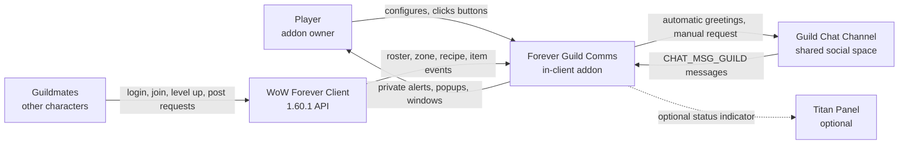

# Business Overview

## Business Context Diagram



### Text Alternative

```
Player               -> configures and clicks   -> Addon
Addon                -> private alerts, popups  -> Player
Addon                -> greetings and requests  -> Guild Chat Channel
Guild Chat Channel   -> incoming guild messages -> Addon
WoW Forever Client   -> roster/zone/recipe data -> Addon
Guildmates           -> act in the world        -> WoW Forever Client
Addon                -> optional indicator      -> Titan Panel
```

## Business Description

- **Business Description**: Forever Guild Comms is a guild social and communication
  assistant for World of Warcraft: Forever. Its business purpose is to reduce the social
  friction of running a guild: it notices the guild events a player would otherwise miss
  (a member coming online, a new member joining, a member levelling up) and speaks on the
  player's behalf in guild chat, while privately surfacing requests from guild chat that
  the player is specifically able to answer. It is a *communication* product, not an
  automation product: it never takes a game action for the player.

- **Business Transactions**: The system implements nine business transactions.

| # | Transaction | Trigger | Outcome | Visibility |
| --- | --- | --- | --- | --- |
| BT-1 | Greet a returning guildmate | Roster diff shows offline to online | One templated greeting queued to guild chat | Public |
| BT-2 | Welcome a new guild member | Localized guild-join system message | One templated welcome queued to guild chat | Public |
| BT-3 | Congratulate a level-up | Roster diff shows a higher level while online | One templated congratulation queued to guild chat | Public |
| BT-4 | Surface a craft request | Guild chat message matches a request phrase AND a cached known recipe | Private alert in the local chat frame and the Alerts window | Private |
| BT-5 | Surface a group request | Guild chat message matches an LFG/LFM pattern and is not a craft request | Private alert in the local chat frame and the Alerts window | Private |
| BT-6 | Remind about the guild tabard | Entering or leaving a capital city | A popup that can open the character panel, nothing more | Private |
| BT-7 | Ask the guild for help | Player fills the compose window and clicks Send | Exactly one guild chat message, rate-limited to one per 20 seconds | Public, explicit |
| BT-8 | Maintain the known-recipe cache | Opening a profession window or learning a recipe | Per-character cache of learned recipe and output names | Private |
| BT-9 | Report guild status | `/fgc status`, the Alerts window, or the Titan tooltip | Online count, member count, pending alert count | Private |

- **Business Dictionary**:

| Term | Meaning in this system |
| --- | --- |
| Baseline | The first roster read after login, reload, or a guild change. It updates state and deliberately sends nothing, so the addon never greets everyone at once. |
| Roster diff | Comparison of a fresh roster read against the retained previous read; the only source of BT-1 and BT-3. |
| Private alert | A notification shown only to the player. Never emitted to guild chat or a whisper. |
| Public message | Text sent to the guild chat channel. Only BT-1, BT-2, BT-3, and BT-7 produce one. |
| Queue | The spacing mechanism that holds automatic messages and releases them at least `max(3, messageSpacing)` seconds apart. |
| Cooldown key | A `kind:normalizedName[:detail]` string used to suppress duplicate messages within a time window. |
| Self-exclusion | Dropping any event whose subject is the player, checked by GUID first then normalized name. The product's headline rule is that the player's own level-up is never announced. |
| Normalized name | A character name lowercased, trimmed, and whitespace-collapsed by `A:Key`, used for all table keys. |
| Template | A user-editable message string with `{name}`, `{level}`, `{type}`, `{activity}`, `{myroles}`, `{needed}` placeholders, clamped to 250 characters. |
| Request phrase | One of twelve plain-substring crafting phrases, or one of the LFG/LFM patterns, that marks a guild chat line as an actual request rather than conversation. |

### Dominant Business Constraint

The product's own risk model, recorded in `.kiro/steering/guild-chat-safety.md`, states
that spam, a duplicate, or a message sent about the wrong person is the worst failure
mode the system has, and is worse than a missed greeting. Every public transaction
(BT-1, BT-2, BT-3) is therefore deliberately lossy: it prefers silence to a false
positive. This asymmetry is the single most important thing to preserve in any change.

## Component Level Business Descriptions

### Core.lua
- **Purpose**: Owns the shared namespace, user settings, and the one channel through which
  all guild chat leaves the addon.
- **Responsibilities**: Default settings and SavedVariables backfill; identity helpers
  (`Key`, `IsSelf`); the gatekeeper `CanUse`; duplicate suppression (`IsDuplicate`); the
  send queue (`QueueGuild`, `DrainQueue`, `SendGuild`); slash commands; the single event
  dispatcher.

### Roster.lua
- **Purpose**: Turns the guild roster into the three public social events.
- **Responsibilities**: Throttled roster requests; roster reads; baseline capture; the
  diff that produces BT-1 and BT-3; parsing the localized guild-join message for BT-2;
  discarding suspicious roster reads; clearing queued text on a guild change.

### Alerts.lua
- **Purpose**: Finds the guild chat requests this specific player can answer.
- **Responsibilities**: Stripping chat escape codes; craft and group request phrase
  detection; scanning and caching learned recipes per character; exact recipe-name
  matching; appending to the capped private alert list (BT-4, BT-5, BT-8).

### Tabard.lua
- **Purpose**: A courtesy reminder about guild identity in capital cities (BT-6).
- **Responsibilities**: City detection by map ID then zone name; checking the tabard
  slot; showing one of two popups. Explicitly does not equip or unequip anything.

### UI.lua
- **Purpose**: The player's two windows.
- **Responsibilities**: The paged Alerts inbox with a manual Whisper button that only
  opens the chat edit box; the Ask-for-Help compose window with live preview, role
  selection, and the single explicit send (BT-7).

### Options.lua
- **Purpose**: Lets the player turn each transaction on or off and rewrite its wording.
- **Responsibilities**: Registering a Settings canvas panel; per-feature toggles;
  template edit boxes; refresh, commit, and restore-defaults behavior.

### Broker.lua
- **Purpose**: Optional at-a-glance status (BT-9).
- **Responsibilities**: Detecting LibDataBroker at runtime and publishing a data object
  with counts and click handlers. Entirely absent-safe.

### tests/smoke.lua
- **Purpose**: Protects the safety invariants of BT-1 through BT-5 and BT-8 offline.
- **Responsibilities**: Stubbing client globals, loading the three testable modules, and
  asserting both the positive case and the must-not-fire case for each.
