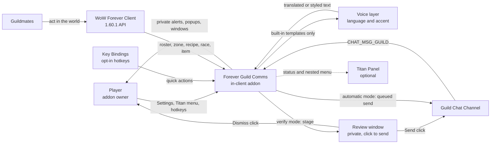

# Business Overview

**Analysis target**: Forever Guild Comms **0.4.3-beta**
**Supersedes**: the 0.4.1-beta pass of 2026-10-19T02:40:00Z
**Releases covered since 0.2.0**: 0.3.0 (Titan nested menu, timing controls), 0.4.0
(languages and accents), 0.4.1 (opt-in key bindings), 0.4.2 (varied message wording),
0.4.3 (tabard ordering and dedup-cache maintenance)

## Business Context Diagram



### Text Alternative

```
Player / Key Bindings / Titan menu -> Addon
Addon -> built-in templates only    -> Voice layer (language + accent)
Voice layer -> translated or styled -> Addon
Addon -> automatic mode             -> Guild Chat Channel
Addon -> verify mode                -> Review window -> Send click -> Guild Chat
                                                     -> Dismiss    -> discarded
Guild Chat -> incoming messages     -> Addon
Client     -> roster/zone/recipe/race data -> Addon
Addon      -> private alerts and popups    -> Player
Addon      -> optional status and menu     -> Titan Panel
```

## Business Description

- **Business Description**: Forever Guild Comms is a guild social and communication
  assistant for World of Warcraft: Forever. Its purpose is to reduce the social friction
  of running a guild: it notices the guild events a player would otherwise miss (a member
  coming online, a new member joining, a member levelling up) and speaks on the player's
  behalf in guild chat, while privately surfacing requests from guild chat that the player
  is specifically able to answer. It is a *communication* product, not an automation
  product: it never takes a game action for the player.

- **What changed across 0.3.0 to 0.4.1**: the product grew three new layers, none of which
  altered the core safety model.

  **0.3.0 — control.** A nested Titan Panel menu exposes almost every setting without
  opening the Settings page, and the two previously unreachable timing values
  (`messageSpacing`, `loginCooldown`) became editable with validated limits. All writes now
  funnel through one validating setter, so the two UIs cannot disagree.

  **0.4.0 — voice.** The addon's own generated messages can be translated into eight
  languages and given one of 29 curated regional or WoW-race RP styles, stored per
  character. Crucially this applies *only* to unmodified built-in templates: the moment a
  player edits a template, their text wins and is never rewritten.

  **0.4.1 — access.** The three private quick actions became assignable hotkeys. Nothing
  is bound by default, and no binding can send guild chat.

  **0.4.2 — variety.** The product's oldest latent social weakness was that it said the
  same sentence every time. 204 additional curated templates now back the four built-in
  messages, selected by a shuffle bag that exhausts every wording before repeating and
  avoids adjacent duplicates. The help composer caches its chosen draft so the preview and
  the sent text cannot differ.

  **0.4.3 — maintenance.** Two defects that had been carried in the analysis since the
  first pass were fixed: the login-time tabard reminder could be masked by an earlier zone
  check, and the duplicate-suppression cache grew without bound for a session. Both landed
  with a dedicated regression harness.

- **Business Transactions**: fourteen, up from thirteen.

| # | Transaction | Trigger | Outcome | Visibility |
| --- | --- | --- | --- | --- |
| BT-1 | Greet a returning guildmate | Roster diff shows offline to online | Templated greeting, translated or styled if selected; queued or staged per mode | Public or staged |
| BT-2 | Welcome a new guild member | Localized guild-join system message | As BT-1 | Public or staged |
| BT-3 | Congratulate a level-up | Roster diff shows a higher level while online | As BT-1 | Public or staged |
| BT-4 | Surface a craft request | Guild chat matches a request phrase AND a cached known recipe | Private alert | Private |
| BT-5 | Surface a group request | Guild chat matches an LFG/LFM pattern, not a craft request | Private alert | Private |
| BT-6 | Remind about the guild tabard | Entering or leaving a capital city | A popup that can open the character panel | Private |
| BT-7 | Ask the guild for help | Player fills the composer and clicks Send | One guild message, rate-limited to one per 20s, localized role and activity labels | Public, explicit |
| BT-8 | Maintain the known-recipe cache | Opening a profession window, learning a recipe, or the rescan quick action | Per-character cache; the rescan path now reports success or failure honestly | Private |
| BT-9 | Report guild status | `/fgc status`, Alerts window, Titan tooltip | Counts, pending review depth, current mode | Private |
| BT-10 | Review a staged message | Player clicks Send, Dismiss, or Dismiss all | Send posts that one message; Dismiss discards it | Private, resolves to public only on an explicit Send |
| **BT-11** | **Translate or style a built-in message** | **Player selects a language, accent, race filter, and strength** | **Built-in templates are replaced with a curated translation or RP variant, per character** | **Private configuration; affects public message wording** |
| **BT-12** | **Adjust settings from the Titan nested menu** | **Right-click the Titan broker** | **Any boolean, the outgoing mode, timing presets, and voice options change through the same validating setter as Settings** | **Private** |
| BT-13 | Invoke a quick action by hotkey | A key the player assigned under Options > Key Bindings > AddOns | Opens alerts, opens the help composer, or rescans the open profession. Never sends | Private |
| **BT-14** | **Vary the wording of a built-in message** | **Any of BT-1, BT-2, BT-3, or BT-7 while `randomizeMessages` is on** | **A shuffle bag picks one of the curated phrasings for the active language and accent, exhausting all of them before repeating and never repeating adjacently** | **Private selection; affects public message wording** |

### BT-11 in detail

The voice layer is the most behaviourally subtle addition in these three releases, and its
business rules are deliberately narrow:

| Rule | Behaviour |
| --- | --- |
| **A customized template always wins** | `A:VoiceText` compares the stored template against the shipped default. If they differ, the player's text is formatted as-is and neither translated nor accented. This is what protects item links, colour codes, and player intent. |
| Only four built-in templates are in scope | `login`, `join`, `level`, `help`. Nothing else the addon or the player writes is touched. |
| No global chat hooks | Guild chat, whispers, and arbitrary text are never rewritten. The module comment states this explicitly. |
| Per-character storage | Preferences live in `A.char.voice`, so one account can run an Orcish warrior and a Spanish-speaking mage side by side. Existing account-wide settings are untouched. |
| Defaults preserve existing behaviour | English, accent `none`, so upgrading changes nothing a player already posts. |
| Incompatible selections self-heal | Changing language or the race filter revalidates the chosen accent and reverts to `auto` rather than silently using a mismatched style. |
| Unknown races degrade safely | An unrecognised race yields only `auto` and `none`, and `ResolveAccent` returns nil. |
| Styles are flavour, not mimicry | The source states the variants are creative RP flavour, not phonetic claims about real people, and that Blizzard's invented languages are not imitated. |

- **Business Dictionary** (new and changed terms marked):

| Term | Meaning in this system |
| --- | --- |
| **Voice** *(new)* | The per-character combination of language, accent, race filter, and accent strength held in `A.char.voice`. |
| **Accent / style** *(new)* | One of 29 curated whole-phrase template sets, each bound to one language, with an optional flair prefix. Covers 8 regional human voices, 13 WoW-race RP voices, and 8 regional variants of the translated languages. |
| **Accent strength** *(new)* | `subtle`, `moderate`, or `expressive`. Subtle applies the style's phrasing with no flair prefix; moderate prepends the flair; expressive prepends it and intensifies terminal punctuation. Never applied to the `help` template. |
| **Race filter** *(new)* | When on, restricts the accent list to styles mapped to the player's race by `A.raceAccents`, plus the regional human set when the player is Human. |
| **Built-in template** | A template whose stored text still equals the shipped default, and is therefore eligible for translation, styling, and variation. A **customized template** is not. |
| **Variant** *(new)* | One of 204 curated alternative phrasings for a built-in template, keyed by language or accent and by kind. |
| **Shuffle bag** *(new)* | The per-combination selection state in `A.messageVariantBags`: a shuffled order plus a position, which exhausts every wording before reshuffling and avoids repeating the previous bag's final pick. Session-local, never persisted. |
| **Draft** *(new)* | The cached help-request text in `A.requestDraft`, held with a fingerprint so a redraw cannot change what the Send button will post. |
| **Retention window** *(new)* | How long a dedup key is kept: `timingLimits.loginCooldown.max`, 3600 seconds. Deliberately the longest *supported* cooldown rather than the configured one. |
| **Quick action** *(new)* | One of `alerts`, `help`, `rescan`, dispatched through `A:RunQuickAction` from the Titan menu or a key binding. None sends guild chat. |
| **Timing limit** *(new)* | The clamp range for a saved timing value: `messageSpacing` 3-120s, `loginCooldown` 0-3600s. Enforced on load and on every write. |
| Outgoing mode | `A.db.outgoingMode`, `"automatic"` or `"verify"`. Governs only BT-1, BT-2, BT-3. |
| Staged message | An entry in `A.pendingApprovals` awaiting an explicit Send click. |
| Message entry | A `{text, kind, guild, time}` record. The `guild` field detects a stale message after a guild change. |
| Baseline | The first roster read after login, reload, or a guild change. Updates state, sends nothing. |
| Private alert | Shown only to the player. Never emitted to guild chat or a whisper. |
| Cooldown key | `kind:normalizedName[:detail]`, used for duplicate suppression and to label review rows. |
| Self-exclusion | Dropping any event whose subject is the player, GUID first then normalized name. |
| Template | A user-editable string with `{name}`, `{level}`, `{type}`, `{activity}`, `{myroles}`, `{needed}` placeholders, clamped to 250 **bytes** on a UTF-8 character boundary. |

### BT-14 in detail

Varying wording sounds cosmetic but touches the product's core promise, so its rules are
tight:

| Rule | Behaviour |
| --- | --- |
| **Only curated whole templates** | Variants are complete alternative sentences written by hand, not generated. Nothing substitutes syllables or transforms text |
| **A customized template is never varied** | The same precedence rule as translation: if the stored template differs from the shipped default, it is used verbatim and the shuffle bag is not consulted |
| **The preview is the message** | `A:RequestText` caches its chosen draft behind a fingerprint over the template, the randomize flag, all four voice settings, and all five interpolated values. A redraw or a reopened Settings panel cannot silently change a pending draft. The draft is cleared when the composer is opened afresh and after a successful send |
| **The Settings sample does not consume a draw** | `CommsText(..., preview=true)` skips variant selection entirely, so opening Settings neither advances nor disturbs the shuffle bag |
| **Exhaust before repeating** | Each language/accent/kind combination has its own bag; every wording is used once before reshuffling, and the first entry of a new bag is swapped if it would repeat the previous bag's last pick |
| **Session-local** | `A.messageVariantBags` is never persisted, so a reload simply reshuffles |
| **Placeholders survive** | Asserted for every language and accent by `tests/variations.lua`, including that the activity and level values appear in the output |

One honest caveat on defaults. The project's established convention, stated explicitly in
the README for the 0.4.0 voice feature, is that a new option should default to preserving
existing behaviour. `randomizeMessages` departs from that: it defaults to **on**, so
upgrading does change the wording an existing user posts. The change is confined to
curated text that still honours their language and accent, and the README documents the
default plainly rather than hiding it, so this reads as a deliberate product call rather
than an oversight. It is nonetheless the first new setting in the project's history that
alters existing output on upgrade.

### Dominant Business Constraint

The risk model in `.kiro/steering/guild-chat-safety.md` still holds: spam, a duplicate, or
a message about the wrong person is the worst failure this system can produce, and is
worse than a missed greeting.

Across these five releases the constraint was extended rather than diluted. The voice and
variant layers only ever substitute *whole curated phrases* for *unmodified built-in
templates*, so they cannot corrupt a link or a name. The Titan menu writes exclusively
through `A:SetOption`, which refuses template edits outright. The key bindings expose only
the three actions that cannot send. The byte-limit logic was hardened precisely because
translation introduced multibyte characters that a naive truncation would have split. And
0.4.3 went back to close two reliability defects rather than add surface.

Two details show the constraint being applied to the *new* feature rather than merely
preserved around it. Draft caching exists so that a randomized message cannot differ
between what the user approved and what was sent — a failure mode that only became
possible once wording varied. And the dedup-cache pruning deliberately retains entries for
the longest *supported* cooldown rather than the currently configured one, because a
shorter retention would let a suppressed event through if the user later raised
`loginCooldown`. Both choices cost a little complexity to protect against a duplicate
reaching guild chat.

## Component Level Business Descriptions

### Core.lua
- **Purpose**: Shared namespace, settings, the single outbound chat path, the approval
  backlog, and the validating setters.
- **Responsibilities**: Defaults and SavedVariables migration (mode, blank templates, and
  now timing clamps and voice validation); identity helpers; `CanUse`; duplicate
  suppression; UTF-8-safe `ChatLimit`; the `CommsText` indirection that makes the voice
  layer optional; the send queue; the approval backlog; `SetOption` and `SetVoiceOption`;
  `NormalizeTiming`; `RunQuickAction`; the key-binding label globals; slash commands; the
  single event dispatcher.

### Languages.lua *(new in 0.4.0)*
- **Purpose**: Offline translation data. No logic.
- **Responsibilities**: The eight-language list, `localeTemplates` for the four built-in
  templates, and localized role names and activity types. Explicitly not a
  machine-translation service.

### Accents.lua *(new in 0.4.0)*
- **Purpose**: Curated style data. No logic beyond a local `register` helper.
- **Responsibilities**: 29 styles, each with a language binding, four phrase templates, and
  an optional flair prefix, plus `accentOrder` for stable presentation.

### MessageVariants.lua *(new in 0.4.2)*
- **Purpose**: Additional curated phrasings, plus the selection algorithm (BT-14).
- **Responsibilities**: `A.localeVariants` (68 alternatives across 8 languages) and
  `A.accentVariants` (136 across all 29 accents), every language and accent covering all
  four kinds; `A.messageVariantBags` holding session-local selection state; and
  `A:ChooseMessageTemplate`, the shuffle bag that assembles the candidate list, reshuffles
  on exhaustion, and swaps the leading entry to avoid an adjacent repeat. The header
  comment restates the boundary: curated additions only, no transformation of names,
  hyperlinks, item IDs, activity names, or placeholder values.

### RaceProfiles.lua *(new in 0.4.0)*
- **Purpose**: The voice layer's logic.
- **Responsibilities**: The race-to-style map; `GetPlayerRace` with Forever-specific
  Skyborne probing; `GetAvailableAccents` applying the language and race filters;
  `ResolveAccent` including `auto`; `VoiceText` implementing the customized-template-wins
  rule and the strength behaviour; localized role and activity labels.

### Roster.lua
- **Purpose**: Convert roster state changes into the three public social events.
- **Responsibilities**: Unchanged logic, but the three message sites now call
  `A:CommsText` instead of `A:Format`, so greetings honour the voice settings.

### Alerts.lua
- **Purpose**: Find the guild chat requests this player can answer.
- **Responsibilities**: Unchanged, except `ScanRecipes` now returns a boolean so callers
  can report whether a profession was actually scanned.

### Tabard.lua
- **Purpose**: Capital-city tabard reminder (BT-6).
- **Responsibilities**: City detection, tabard slot check, two popups. **Changed in 0.4.3
  for the first time since 0.1.0**: the login-time check can no longer be masked by an
  earlier zone-transition check, and at most one city reminder appears per uninterrupted
  stay. No longer the untested module — `tests/tabard_dedup.lua` covers it.

### UI.lua
- **Purpose**: The player's three windows.
- **Responsibilities**: Alerts inbox with the review shortcut; the review window; the
  Ask-for-Help composer, whose preview and payload now use `CommsText` and localized role
  and activity labels, switching to the untranslated path when the help template is
  customized.

### Options.lua
- **Purpose**: The full Settings surface.
- **Responsibilities**: Toggles, the mode radio pair, numeric timing fields, template
  editors with Use default buttons, the new Languages and accents section with a live
  preview, and the scroll anchors that let the Titan menu deep-link to a section.

### TitanMenu.lua *(new in 0.3.0)*
- **Purpose**: Nested right-click configuration without opening Settings.
- **Responsibilities**: Build the menu tree through Blizzard `MenuUtil`, falling back to
  the Settings page when the client does not provide it; expose booleans, mode, timing
  presets, and voice options; route quick actions through `RunQuickAction`; deliberately
  refuse to edit template text, offering a Settings shortcut instead.

### Broker.lua
- **Purpose**: Optional status indicator and the menu's entry point.
- **Responsibilities**: Publish the LibDataBroker object; report counts, pending reviews,
  and mode; route clicks, including right-click into the nested menu.

### Bindings.xml *(new in 0.4.1, shipped but not in the TOC)*
- **Purpose**: Declare three opt-in hotkeys.
- **Responsibilities**: Map `FGC_OPEN_ALERTS`, `FGC_ASK_HELP`, and
  `FGC_RESCAN_PROFESSION` to `RunQuickAction` behind a global existence check. No
  `default=` attribute, so no key is claimed without the player assigning it.

### tests/ (eleven harnesses, up from nine)
- **Purpose**: Protect the invariants offline.
- **Responsibilities**: `syntax` compiles every module; `smoke` covers roster and chat
  parsing; `verify` covers the approval workflow; `settings` covers migration and the
  options widgets; `timing` asserts the exact queue delays and cooldown behaviour;
  `titanmenu` drives the LDB object and the whole menu tree; `voice` covers languages,
  filtering, custom-template precedence, and UTF-8 truncation; `keybindings` executes the
  real XML handlers; `icon` checks the icon wiring across four files; **`tabard_dedup`
  reproduces the login-ordering race and the dedup-cache lifecycle; `variations` covers
  the shuffle bag across every language and accent plus preview/send stability**. Every
  module is now loaded by at least one harness.
