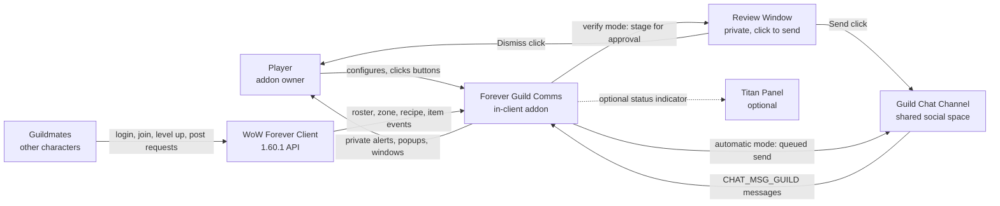

# Business Overview

**Analysis target**: Forever Guild Comms **0.2.0-beta**
**Supersedes**: the 0.1.0-beta pass of 2026-10-18

## Business Context Diagram



### Text Alternative

```
Player               -> configures and clicks   -> Addon
Addon                -> private alerts, popups  -> Player
Addon                -> stage (verify mode)     -> Review Window
Review Window        -> Send click              -> Guild Chat Channel
Review Window        -> Dismiss click           -> discarded, nothing sent
Addon                -> queued send (auto mode) -> Guild Chat Channel
Guild Chat Channel   -> incoming guild messages -> Addon
WoW Forever Client   -> roster/zone/recipe data -> Addon
Guildmates           -> act in the world        -> WoW Forever Client
Addon                -> optional indicator      -> Titan Panel
```

## Business Description

- **Business Description**: Forever Guild Comms is a guild social and communication
  assistant for World of Warcraft: Forever. Its business purpose is to reduce the social
  friction of running a guild: it notices the guild events a player would otherwise miss
  (a member coming online, a new member joining, a member levelling up) and speaks on the
  player's behalf in guild chat, while privately surfacing requests from guild chat that
  the player is specifically able to answer. It is a *communication* product, not an
  automation product: it never takes a game action for the player.

- **What changed in 0.2.0**: the product no longer forces a choice between "the addon
  speaks for me" and "the addon is off". A new **outgoing mode** setting offers
  *Automatic* (the 0.1.0 behavior, unchanged and still the default) or *Verify with a
  click*, in which the three roster-driven messages are staged in a private review window
  and nothing reaches guild chat until the player clicks Send on that specific message.
  This converts the product's riskiest capability — speaking publicly without the player
  present — into an opt-in, reviewable one.

- **Business Transactions**: ten transactions, up from nine.

| # | Transaction | Trigger | Outcome | Visibility |
| --- | --- | --- | --- | --- |
| BT-1 | Greet a returning guildmate | Roster diff shows offline to online | Automatic mode: one templated greeting queued to guild chat. Verify mode: staged for approval | Public or staged |
| BT-2 | Welcome a new guild member | Localized guild-join system message | Automatic mode: one templated welcome queued. Verify mode: staged for approval | Public or staged |
| BT-3 | Congratulate a level-up | Roster diff shows a higher level while online | Automatic mode: one templated congratulation queued. Verify mode: staged for approval | Public or staged |
| BT-4 | Surface a craft request | Guild chat message matches a request phrase AND a cached known recipe | Private alert in the local chat frame and the Alerts window | Private |
| BT-5 | Surface a group request | Guild chat message matches an LFG/LFM pattern and is not a craft request | Private alert in the local chat frame and the Alerts window | Private |
| BT-6 | Remind about the guild tabard | Entering or leaving a capital city | A popup that can open the character panel, nothing more | Private |
| BT-7 | Ask the guild for help | Player fills the compose window and clicks Send | Exactly one guild chat message, rate-limited to one per 20 seconds | Public, explicit |
| BT-8 | Maintain the known-recipe cache | Opening a profession window or learning a recipe | Per-character cache of learned recipe and output names | Private |
| BT-9 | Report guild status | `/fgc status`, the Alerts window, or the Titan tooltip | Online count, member count, alert count, pending review count, current mode | Private |
| **BT-10** | **Review a staged message** | **Player opens the review window and clicks Send, Dismiss, or Dismiss all** | **Send posts that one message; Dismiss discards it; neither is automatic** | **Private, resolves to public only on an explicit Send** |

### BT-10 in detail

The new transaction is the reason the release exists, and its business rules are
unusually strict:

| Rule | Behavior |
| --- | --- |
| Nothing posts without a click | Staged messages sit indefinitely. There is no timeout that auto-sends. |
| Switching back to Automatic does not release the backlog | Messages staged under Verify must still be individually approved or dismissed. Changing the mode is not approval. |
| Switching to Verify mid-flight captures the message | A message already waiting in the automatic spacing queue is re-routed to the review window when its timer fires, rather than being posted. |
| A guild change voids the backlog | Staged messages are cleared on a guild change, and an approval whose recorded guild no longer matches the current guild is discarded with an explanatory message rather than sent. |
| Dismiss never touches guild chat | Neither Dismiss nor Dismiss all can produce a message. |
| The backlog is bounded | 30 entries. A flood drops the oldest unreviewed entry rather than growing without limit. |

- **Business Dictionary** (new and changed terms marked):

| Term | Meaning in this system |
| --- | --- |
| **Outgoing mode** *(new)* | `A.db.outgoingMode`, either `"automatic"` or `"verify"`. Governs only the three roster-driven public messages. Alerts and the manual help request are unaffected. |
| **Staged message** *(new)* | An entry in `A.pendingApprovals`: a fully rendered message that has passed every safety guard and is waiting for an explicit Send click. It has been *composed* but not *sent*. |
| **Approval** *(new)* | The Send click in the review window. The click is the confirmation; no delayed send is scheduled after it. |
| **Dismiss** *(new)* | Discarding a staged message. Removes it from the backlog and sends nothing. |
| **Message entry** *(changed)* | Queued and staged messages are now records, `{text, kind, guild, time}`, not bare strings. The `guild` field is what lets a stale message be detected and discarded after a guild change. |
| Baseline | The first roster read after login, reload, or a guild change. It updates state and deliberately sends nothing, so the addon never greets everyone at once. |
| Roster diff | Comparison of a fresh roster read against the retained previous read; the only source of BT-1 and BT-3. |
| Private alert | A notification shown only to the player. Never emitted to guild chat or a whisper. |
| Public message | Text sent to the guild chat channel. Only BT-1, BT-2, BT-3, BT-7, and an approved BT-10 produce one. |
| Queue | The spacing mechanism that holds automatic messages and releases them at least `max(3, messageSpacing)` seconds apart. |
| Cooldown key | A `kind:normalizedName[:detail]` string used to suppress duplicate messages within a time window. In 0.2.0 the leading `kind` segment is also parsed back out to label the message in the review window. |
| Self-exclusion | Dropping any event whose subject is the player, checked by GUID first then normalized name. The product's headline rule is that the player's own level-up is never announced. |
| Normalized name | A character name lowercased, trimmed, and whitespace-collapsed by `A:Key`, used for all table keys. |
| Template | A user-editable message string with `{name}`, `{level}`, `{type}`, `{activity}`, `{myroles}`, `{needed}` placeholders, clamped to 250 characters. In 0.2.0 a blank template is replaced by its default on load, and each template has a *Use default* button. |

### Dominant Business Constraint

The product's risk model, recorded in `.kiro/steering/guild-chat-safety.md`, states that
spam, a duplicate, or a message sent about the wrong person is the worst failure mode the
system has, and is worse than a missed greeting. Every public transaction is therefore
deliberately lossy: it prefers silence to a false positive.

0.2.0 extends this rather than relaxing it. The new mode adds a *sixth* gate in front of
the three roster-driven messages — after `CanUse`, the feature toggle, self-exclusion,
dedup, and spacing, there can now also be a human. Notably, every edge case in the new
code resolves toward *not sending*: a mode switch mid-flight stages instead of posting, a
guild mismatch discards instead of posting, and a full backlog drops the oldest unsent
entry rather than flushing it.

## Component Level Business Descriptions

### Core.lua
- **Purpose**: Owns the shared namespace, user settings, and the one channel through which
  all guild chat leaves the addon.
- **Responsibilities**: Default settings, SavedVariables backfill, and a new migration
  that normalizes an invalid outgoing mode and refills blank templates; identity helpers
  (`Key`, `IsSelf`); the gatekeeper `CanUse`; duplicate suppression (`IsDuplicate`); the
  send queue (`QueueGuild`, `DrainQueue`, `SendGuild`); **the approval backlog
  (`StageApproval`, `ApproveMessage`, `DismissMessage`, `ClearApprovals`)**; slash
  commands; the single event dispatcher.

### Roster.lua
- **Purpose**: Turns the guild roster into the three public social events.
- **Responsibilities**: Throttled roster requests; roster reads; baseline capture; the
  diff that produces BT-1 and BT-3; parsing the localized guild-join message for BT-2;
  discarding suspicious roster reads; clearing queued text **and the approval backlog**
  on a guild change.

### Alerts.lua
- **Purpose**: Finds the guild chat requests this specific player can answer.
- **Responsibilities**: Stripping chat escape codes; craft and group request phrase
  detection; scanning and caching learned recipes per character; exact recipe-name
  matching; appending to the capped private alert list (BT-4, BT-5, BT-8). Unchanged in
  0.2.0.

### Tabard.lua
- **Purpose**: A courtesy reminder about guild identity in capital cities (BT-6).
- **Responsibilities**: City detection by map ID then zone name; checking the tabard
  slot; showing one of two popups. Explicitly does not equip or unequip anything.
  Unchanged in 0.2.0.

### UI.lua
- **Purpose**: The player's three windows.
- **Responsibilities**: The paged Alerts inbox, now carrying a live `Review (n)` shortcut
  button; **the new paged review window (BT-10) with per-row Send and Dismiss, a Dismiss
  all control, and an empty-state label**; the Ask-for-Help compose window with live
  preview, role selection, and the single explicit send (BT-7).

### Options.lua
- **Purpose**: Lets the player turn each transaction on or off, choose how outgoing
  messages are handled, and rewrite their wording.
- **Responsibilities**: Registering a Settings canvas panel; **the Automatic / Verify
  radio pair, which warns when switching to Automatic with a non-empty backlog**;
  per-feature toggles; template edit boxes **now showing their default text and offering
  a per-template Use default button**; refresh, commit, and restore-defaults behavior.

### Broker.lua
- **Purpose**: Optional at-a-glance status (BT-9).
- **Responsibilities**: Detecting LibDataBroker at runtime and publishing a data object
  with counts and click handlers. **Now surfaces the pending review count and the current
  mode, and left-click prioritizes the review window whenever messages are waiting.**
  Entirely absent-safe.

### tests/ (four harnesses, up from one)
- **Purpose**: Protect the safety invariants offline.
- **Responsibilities**: `smoke.lua` covers roster diffing, chat parsing, and the recipe
  cache. **`verify.lua` covers the whole approval workflow including the mode-switch and
  guild-change invariants. `settings.lua` covers SavedVariables migration and the options
  widgets. `syntax.lua` compiles all seven shipped modules.** None are listed in the TOC
  or shipped.
