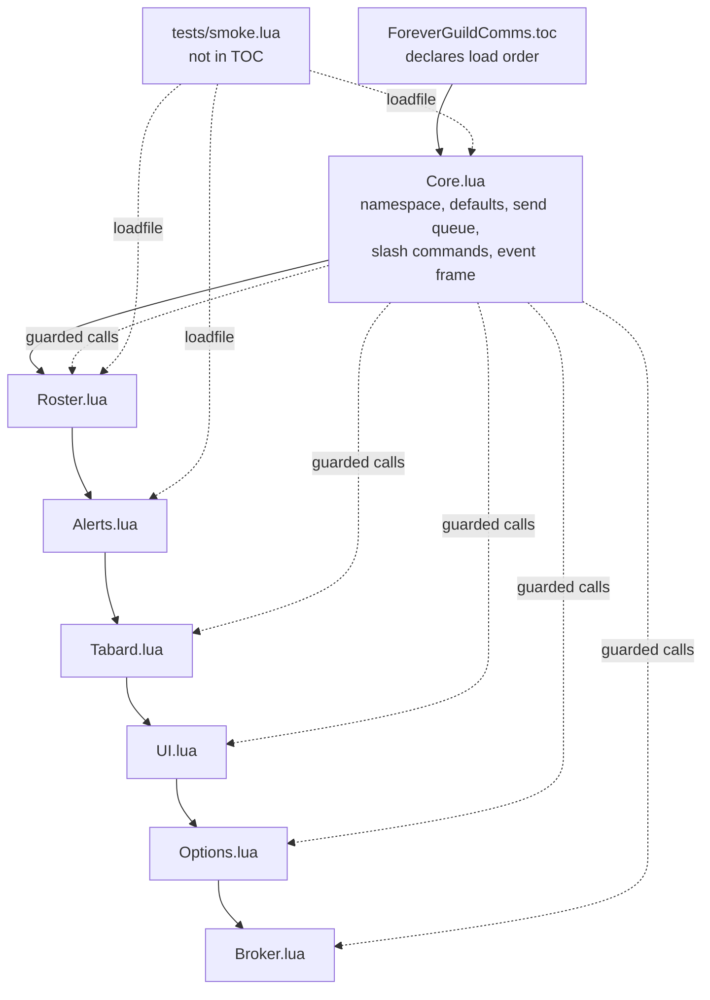
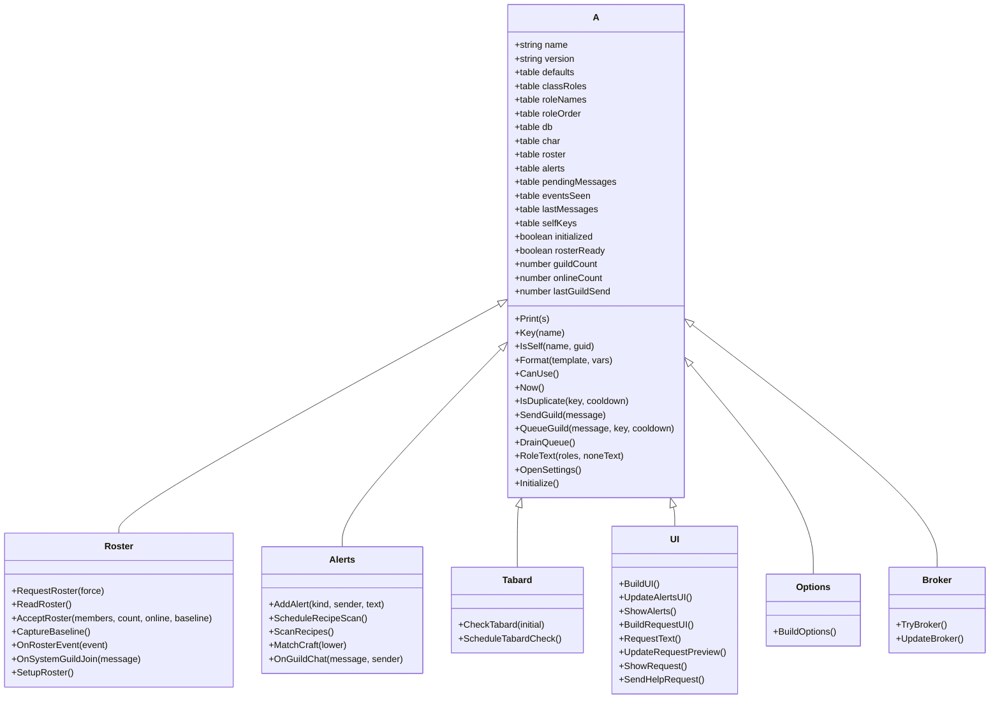

# Code Structure

## Build System

- **Type**: None. There is no build step, no transpiler, no bundler, no dependency
  manager, and no CI. The `.lua` files are the shipped artifact and the client's embedded
  Lua 5.1 interpreter is the only runtime.
- **Configuration**: `ForeverGuildComms.toc` is the sole manifest. It declares metadata
  and the file load order; the client reads it directly.

```
## Interface: 16001
## Title: Forever Guild Comms
## Notes: Welcomes, guild greetings, levels, crafting and LFG alerts, tabard reminders, and group requests.
## Author: Michael Reilly
## Version: 0.1.0-beta
## SavedVariables: ForeverGuildCommsDB
## SavedVariablesPerCharacter: ForeverGuildCommsCharDB
## OptionalDeps: Titan
Core.lua
Roster.lua
Alerts.lua
Tabard.lua
UI.lua
Options.lua
Broker.lua
```

Load order is significant and not alphabetical: `Core.lua` must be first because it
creates the shared table, declares defaults, and defines the helpers every later file
calls. `tests/smoke.lua` is deliberately absent from the TOC.

- **Packaging**: a zip extracting to `AddOns\ForeverGuildComms\`, containing the `.lua`
  sources, the `.toc`, `README.md`, and `LICENSE`. `.git`, `.kiro`, and `tests` are
  excluded.
- **Version coupling**: three places must move together on every bump, the TOC
  `## Version`, `A.version` in `Core.lua`, and the `README.md` title line. All three
  currently read `0.1.0-beta`.

## Module Hierarchy



### Text Alternative

```
Load order (top to bottom, order matters):
  1. Core.lua      <- creates shared table A, must be first
  2. Roster.lua
  3. Alerts.lua
  4. Tabard.lua
  5. UI.lua
  6. Options.lua
  7. Broker.lua

Not loaded by the client:
     tests/smoke.lua  <- loads Core, Roster, Alerts via loadfile
```

## Existing Files Inventory

These are the candidates for modification in any brownfield change.

| Path | Purpose and responsibility | Lines |
| --- | --- | --- |
| `ForeverGuildComms.toc` | Manifest: interface version, metadata, SavedVariables declarations, optional dependency, file load order | 15 |
| `Core.lua` | Shared table `A` published as `_G.ForeverGuildComms`; `A.defaults`; `A.classRoles`, `A.roleNames`, `A.roleOrder`; state initialization; `fillDefaults`; helpers `Print`, `Key`, `IsSelf`, `Format`, `CanUse`, `Now`, `IsDuplicate`, `RoleText`, `OpenSettings`; send pipeline `SendGuild`, `QueueGuild`, `DrainQueue`; `A:Initialize`; `/fgc` and `/guildcomms`; the single 14-event frame | 227 |
| `Roster.lua` | `A.roster`, `rosterReady`, `rosterGuild`, `baselineTimer`, `lastRosterRequest`; `guildName`; `RequestRoster`, `ReadRoster`, `AcceptRoster`, `CaptureBaseline`, `OnRosterEvent`, `OnSystemGuildJoin`, `SetupRoster` | 122 |
| `Alerts.lua` | `cleanChat`, `looksLikeCraftRequest`, `looksLikeGroupRequest`; `AddAlert`, `ScheduleRecipeScan`, `ScanRecipes`, `MatchCraft`, `OnGuildChat` | 98 |
| `Tabard.lua` | `citiesByName`, `citiesByMapID`; `inMajorCity`, `guildTabardEquipped`; `FGC_TABARD_CITY` and `FGC_TABARD_EXIT` popups; `CheckTabard`, `ScheduleTabardCheck` | 64 |
| `UI.lua` | `Label`, `Button`, `Check`; `BuildUI` (`FGCAlertsFrame`), `UpdateAlertsUI`, `ShowAlerts`, `BuildRequestUI` (`FGCRequestFrame`), `RequestText`, `UpdateRequestPreview`, `ShowRequest`, `SendHelpRequest` | 195 |
| `Options.lua` | `MakeLabel`, `MakeButton`; `BuildOptions` with `section`/`toggle`/`template` closures, `OnRefresh`, `OnCommit`, `OnDefault`, canvas category registration | 142 |
| `Broker.lua` | `TryBroker`, `UpdateBroker` | 34 |
| `tests/smoke.lua` | Offline harness: global stubs, `loadfile` of three modules, eight assertion groups, `PASSED` summary | 72 |
| `README.md` | Install, features, commands, templates, limitations, suggested test sequence, debugging notes. Treated as part of the deliverable | 67 |
| `LICENSE` | License text | 21 |
| `.gitignore` | Blocks compiled Lua, archives, object files, libraries, shared objects, executables | 41 |

**Shipped Lua total**: 882 lines across seven files. Including the TOC, README, LICENSE,
`.gitignore`, and the offline harness, the repository is 1,098 lines.

## Key Modules and Their Public Surface



All seven modules attach their methods to the same table, so the diagram above is a
composition view rather than true inheritance: `Roster`, `Alerts`, `Tabard`, `UI`,
`Options`, and `Broker` are groupings of methods on `A`, not separate classes.

## State Declared on the Shared Table

Every piece of state is declared up front with a safe initial value so that later files
never index nil.

| State | Initial value | Declared in | Meaning |
| --- | --- | --- | --- |
| `A.name` | addon vararg | Core | Addon folder name |
| `A.version` | `"0.1.0-beta"` | Core | Must match TOC and README |
| `A.defaults` | table | Core | Setting defaults and message templates |
| `A.classRoles` | 9-class table | Core | Which roles each Vanilla class can fill |
| `A.roleNames` / `A.roleOrder` | tables | Core | Display labels and stable ordering |
| `A.lastMessages` | `{}` | Core | Declared, currently unused by any code path |
| `A.eventsSeen` | `{}` | Core | Cooldown key to timestamp map for `IsDuplicate` |
| `A.alerts` | `{}` | Core | Private alert list, newest first, capped at 30 |
| `A.onlineCount` / `A.guildCount` | `0` | Core | Roster counts for status and broker |
| `A.lastGuildSend` | `0` | Core | Timestamp of the last queued send |
| `A.pendingMessages` | `{}` | Core | The spacing queue |
| `A.db` / `A.char` | set in `Initialize` | Core | SavedVariables handles |
| `A.playerGuid` / `playerName` / `playerKey` / `selfKeys` | set in `Initialize` | Core | Self-identity for `IsSelf` |
| `A.playerClass` | set in `Initialize` | Core | Drives role availability |
| `A.initialized` | `nil` then `true` | Core | Event gate |
| `A.queueTimer` | `nil` then boolean | Core | Drain latch |
| `A.roster` | `{}` | Roster | Last accepted roster, keyed by normalized name |
| `A.rosterReady` | `false` | Roster | False means the next read is a baseline |
| `A.rosterGuild` | `nil` | Roster | Guild the retained roster belongs to |
| `A.baselineTimer` | `false` | Roster | Baseline debounce latch |
| `A.lastRosterRequest` | `0` | Roster | 30-second request throttle |
| `A.recipeScanPending` | `nil` then boolean | Alerts | Recipe scan debounce latch |
| `A.wasInCity` | `nil` | Tabard | Previous city state; nil means not yet known |
| `A.tabardCheckScheduled` | `nil` then boolean | Tabard | Tabard debounce latch |
| `A.alertFrame` / `alertRows` / `alertPage` / `alertPageText` | set in `BuildUI` | UI | Alerts window handles |
| `A.requestFrame` / `activityEdit` / `roleChecks` / `needChecks` / `requestPreview` | set in `BuildRequestUI` | UI | Compose window handles |
| `A.GetActivityType` | closure | UI | Returns the cycled Dungeon/Raid/Quest value |
| `A.lastManualRequest` | `nil` | UI | 20-second manual send rate limit |
| `A.settingsCategory` | set in `BuildOptions` | Options | Category handle for `OpenSettings` |
| `A.broker` | `nil` | Broker | LibDataBroker data object when available |

## Design Patterns

### Shared-namespace module pattern
- **Location**: every source file, first line.
- **Purpose**: one namespace instead of many globals, with load-order-defined
  composition.
- **Implementation**: `local _, A = ...` captures the addon vararg; methods are attached
  as `function A:Thing()`; file-local helpers stay `local function` and are never exposed.

### Single event dispatcher
- **Location**: bottom of `Core.lua`.
- **Purpose**: one registration point, one initialization gate, no duplicated handlers.
- **Implementation**: one `CreateFrame("Frame")`, 14 `RegisterEvent` calls, and an
  `OnEvent` script that handles `PLAYER_LOGIN` and `ADDON_LOADED` first, then enforces
  `if not A.initialized then return end` before routing anything else.

### Guarded cross-file dispatch
- **Location**: `A:Initialize` and the `OnEvent` body; also `UpdateBroker` and
  `UpdateAlertsUI` call sites in `Roster.lua` and `Alerts.lua`.
- **Purpose**: later modules are optional, so a missing file degrades instead of erroring.
- **Implementation**: `if self.BuildUI then self:BuildUI() end`,
  `if A.OnGuildChat then A:OnGuildChat(...) end`.

### Debounce via timer plus boolean latch
- **Location**: `ScheduleRecipeScan`, `ScheduleTabardCheck`, `baselineTimer` in
  `OnRosterEvent`, `queueTimer` in `DrainQueue`.
- **Purpose**: collapse repeated events into a single run; avoid `OnUpdate` polling.
- **Implementation**: check the latch, set it, `C_Timer.After(delay, ...)`, clear the
  latch inside the callback.

### Queue with cooldown keys
- **Location**: `QueueGuild` into `DrainQueue`.
- **Purpose**: the central guild-chat safety control, combining dedup and spacing.
- **Implementation**: `IsDuplicate(key, cooldown)` rejects repeats; accepted text is
  appended to `pendingMessages`; `DrainQueue` releases one message at a time with at
  least `max(3, db.messageSpacing)` seconds between sends and re-checks `CanUse` on each
  pass, wiping the queue if the player is no longer eligible.

### Defaults backfill (forward-compatible SavedVariables)
- **Location**: `fillDefaults` in `Core.lua`, called from `A:Initialize`.
- **Purpose**: new settings appear for existing users without wiping their choices.
- **Implementation**: recursive walk that writes a default only where the key is nil, and
  recurses where both sides are tables.

### Widget factory closures
- **Location**: `Label`, `Button`, `Check` in `UI.lua`; `MakeLabel`, `MakeButton` and the
  `section`/`toggle`/`template` closures in `Options.lua`.
- **Purpose**: compact, consistent frame construction with a running `y` cursor.
- **Implementation**: file-local functions returning the created widget; `Options.lua`
  additionally collects `controls` refresh closures and `edits` handles for commit.

### Row pooling with paging
- **Location**: `BuildUI` and `UpdateAlertsUI`.
- **Purpose**: display an unbounded alert history with a fixed seven frames.
- **Implementation**: seven reusable row frames; `UpdateAlertsUI` maps
  `alerts[(page-1)*7+i]` onto them, shows or hides each, clamps the page to the computed
  maximum, and truncates text over 78 characters.

### Two-phase identity normalization
- **Location**: `A:Key` and `A:IsSelf`.
- **Purpose**: consistent table keys and reliable self-detection without over-matching.
- **Implementation**: `Key` lowercases, trims, and collapses whitespace; `IsSelf` checks
  GUID equality first, then the normalized name against `selfKeys`, then strips only an
  explicit `-Realm` suffix. The code comments that a name is never shortened further,
  because guildmates can share a first name.

### Pattern escaping for localized globals
- **Location**: `OnSystemGuildJoin`.
- **Purpose**: parse Blizzard's localized guild-join sentence in any client language.
- **Implementation**: escape the Lua pattern metacharacters in `ERR_GUILD_JOIN_S`, then
  convert the escaped `%s` slot into a capture, then anchor the match.

## Critical Dependencies

### WoW Forever client API (1.60.1, Interface 16001)
- **Version**: game version 1.60.1; TOC interface `16001`.
- **Usage**: every external call. The addon targets the modern namespaced API surface
  (`C_Timer`, `C_GuildInfo`, `C_TradeSkillUI`, `C_Map`, `Settings`), not Classic-era
  equivalents, because Forever runs on the modern UI architecture with Vanilla content.
- **Purpose**: the entire runtime. Every call site is feature-detected because the client
  is in beta.

### LibDataBroker-1.1 via LibStub
- **Version**: whatever Titan Panel supplies; no version is pinned or asserted.
- **Usage**: `Broker.lua` only, through `LibStub("LibDataBroker-1.1", true)`.
- **Purpose**: optional status indicator. The silent-failure flag plus the `if not lib
  then return end` guard make this a soft dependency; the addon is fully functional
  without it. Declared `## OptionalDeps: Titan`, never `RequiredDeps`, and no library is
  embedded.

### Standalone Lua 5.1 interpreter (development only)
- **Version**: 5.1.5 recommended, matching the version the client embeds.
- **Usage**: running `tests/smoke.lua`.
- **Purpose**: offline verification. LuaJIT 2.1 works but is a superset, so test code
  must avoid `ffi`, `bit`, `jit`, `table.new`, and `goto`. Lua 5.4 is explicitly
  unsuitable because of the integer/float split and the relocation of `unpack`.
