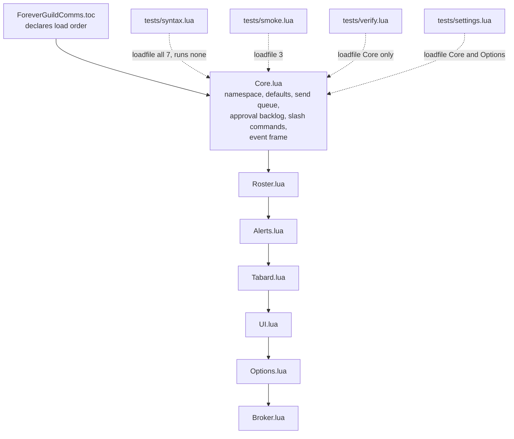
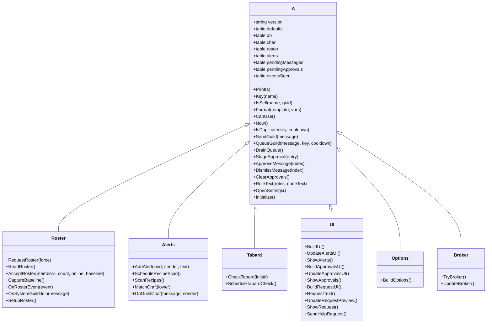

# Code Structure

**Analysis target**: Forever Guild Comms **0.2.0-beta**
**Supersedes**: the 0.1.0-beta pass of 2026-10-18

## Build System

- **Type**: None. There is no build step, no transpiler, no bundler, no dependency
  manager, and no CI. The `.lua` files are the shipped artifact and the client's embedded
  Lua 5.1 interpreter is the only runtime.
- **Configuration**: `ForeverGuildComms.toc` is the sole manifest.

```
## Interface: 16001
## Title: Forever Guild Comms
## Notes: Welcomes, guild greetings, levels, crafting and LFG alerts, tabard reminders, and group requests.
## Author: Michael Reilly
## Version: 0.2.0-beta
## SavedVariables: ForeverGuildCommsDB
## SavedVariablesPerCharacter: ForeverGuildCommsCharDB
## OptionalDeps: Titan
Core.lua
Roster.lua
Alerts.lua
Tabard.lua
UI.lua
Options.lua
Broker.lua
```

The only TOC change in 0.2.0 is the version. No source file was added or removed, so the
load order is untouched. The three new test files are correctly absent, as is
`tests/smoke.lua`.

- **Version coupling check**: all three locations agree at `0.2.0-beta` — the TOC
  `## Version` (line 5), `A.version` in `Core.lua` (line 4), and the `README.md` title
  (line 1). The project's three-place rule is upheld in this release.
- **Interface number**: still `16001`, correctly unchanged.
- **Packaging**: a zip extracting to `AddOns\ForeverGuildComms\`, containing the `.lua`
  sources, the `.toc`, `README.md`, and `LICENSE`. `.git`, `.kiro`, `aidlc-docs`, and
  `tests` are excluded.

## Module Hierarchy



### Text Alternative

```
Load order (top to bottom, order matters):
  1. Core.lua      <- creates shared table A, must be first
  2. Roster.lua
  3. Alerts.lua
  4. Tabard.lua
  5. UI.lua
  6. Options.lua
  7. Broker.lua

Not loaded by the client (four offline harnesses):
     tests/syntax.lua    -> compiles all 7 modules
     tests/smoke.lua     -> Core, Roster, Alerts
     tests/verify.lua    -> Core
     tests/settings.lua  -> Core, Options
```

## Existing Files Inventory

| Path | Purpose and responsibility | Lines | 0.2.0 delta |
| --- | --- | --- | --- |
| `ForeverGuildComms.toc` | Manifest: interface version, metadata, SavedVariables declarations, optional dependency, file load order | 15 | version only |
| `Core.lua` | Shared table `A`; `A.defaults` including the new `outgoingMode`; `A.classRoles`, `A.roleNames`, `A.roleOrder`; state including the new `A.pendingApprovals`; `fillDefaults` plus the mode and template migrations; helpers `Print`, `Key`, `IsSelf`, `Format`, `CanUse`, `Now`, `IsDuplicate`, `RoleText`, `OpenSettings`; send pipeline `SendGuild`, `QueueGuild`, `DrainQueue`; approval backlog `StageApproval`, `ApproveMessage`, `DismissMessage`, `ClearApprovals`; `A:Initialize`; `/fgc` and `/guildcomms`; the single 14-event frame | 306 | **+79** |
| `Roster.lua` | `A.roster`, `rosterReady`, `rosterGuild`, `baselineTimer`, `lastRosterRequest`; `guildName`; `RequestRoster`, `ReadRoster`, `AcceptRoster`, `CaptureBaseline`, `OnRosterEvent`, `OnSystemGuildJoin`, `SetupRoster` | 123 | **+1** |
| `Alerts.lua` | `cleanChat`, `looksLikeCraftRequest`, `looksLikeGroupRequest`; `AddAlert`, `ScheduleRecipeScan`, `ScanRecipes`, `MatchCraft`, `OnGuildChat` | 98 | unchanged |
| `Tabard.lua` | `citiesByName`, `citiesByMapID`; `inMajorCity`, `guildTabardEquipped`; `FGC_TABARD_CITY` and `FGC_TABARD_EXIT` popups; `CheckTabard`, `ScheduleTabardCheck` | 64 | unchanged |
| `UI.lua` | `Label`, `Button`, `Check`; `BuildUI` (`FGCAlertsFrame`) with the new `Review (n)` shortcut, `UpdateAlertsUI`, `ShowAlerts`; `BuildApprovalsUI` (`FGCApprovalsFrame`), `UpdateApprovalsUI`, `ShowApprovals`; `BuildRequestUI` (`FGCRequestFrame`), `RequestText`, `UpdateRequestPreview`, `ShowRequest`, `SendHelpRequest` | 285 | **+90** |
| `Options.lua` | `MakeLabel`, `MakeButton`; `BuildOptions` with `section`/`toggle`/`outgoingMode`/`template` closures, `OnRefresh`, `OnCommit`, `OnDefault`, canvas category registration | 183 | **+41** |
| `Broker.lua` | `TryBroker`, `UpdateBroker` | 38 | **+4** |
| `tests/syntax.lua` | Compiles all seven shipped modules with `loadfile` without executing them | 6 | **new** |
| `tests/smoke.lua` | Roster diffing, guild-join parsing, chat parsing, recipe cache | 72 | unchanged |
| `tests/verify.lua` | The approval workflow against the real queue and backlog code | 66 | **new** |
| `tests/settings.lua` | SavedVariables migration and the Options widgets, via a fake widget harness | 63 | **new** |
| `README.md` | Install, features, commands, the new Automatic-versus-Verify section, templates, limitations, a 10-step test sequence, debugging notes | 78 | **+11** |
| `LICENSE` | License text | 21 | unchanged |
| `.gitignore` | Blocks compiled Lua, archives, object files, libraries, shared objects, executables | 41 | unchanged |

**Shipped Lua total**: 1,097 lines across seven files, up from 882 (+215, +24%).
**Offline harnesses**: 207 lines across four files, up from 72 (+135, +188%).
**Repository total** including the TOC, README, LICENSE, and `.gitignore`: 1,459 lines.

Test code is now 19% of shipped source by line count, up from 8%.

## Key Modules and Their Public Surface



All seven modules attach their methods to the same table, so this is a composition view
rather than true inheritance. **45 `function A:` definitions** in total, up from 38:
Core 17, UI 11, Roster 7, Alerts 5, Tabard 2, Broker 2, Options 1.

## State Declared on the Shared Table

New and changed entries are marked.

| State | Initial value | Declared in | Meaning |
| --- | --- | --- | --- |
| `A.version` | `"0.2.0-beta"` | Core | **Changed.** Must match TOC and README |
| `A.defaults` | table | Core | **Changed.** Now includes `outgoingMode` |
| `A.pendingApprovals` | `{}` | Core | **New.** The approval backlog, capped at 30, newest appended last |
| `A.pendingMessages` | `{}` | Core | **Contract changed.** Now holds entry records, not bare strings |
| `A.name` | addon vararg | Core | Addon folder name |
| `A.classRoles` | 9-class table | Core | Which roles each Vanilla class can fill |
| `A.roleNames` / `A.roleOrder` | tables | Core | Display labels and stable ordering |
| `A.lastMessages` | `{}` | Core | Still declared, still never read or written anywhere |
| `A.eventsSeen` | `{}` | Core | Cooldown key to timestamp map for `IsDuplicate` |
| `A.alerts` | `{}` | Core | Private alert list, newest first, capped at 30 |
| `A.onlineCount` / `A.guildCount` | `0` | Core | Roster counts for status and broker |
| `A.lastGuildSend` | `0` | Core | Timestamp of the last send, now also stamped by `ApproveMessage` |
| `A.db` / `A.char` | set in `Initialize` | Core | SavedVariables handles |
| `A.playerGuid` / `playerName` / `playerKey` / `selfKeys` | set in `Initialize` | Core | Self-identity for `IsSelf` |
| `A.playerClass` | set in `Initialize` | Core | Drives role availability |
| `A.initialized` | `nil` then `true` | Core | Event gate |
| `A.queueTimer` | `nil` then boolean | Core | Drain latch |
| `A.roster` | `{}` | Roster | Last accepted roster, keyed by normalized name |
| `A.rosterReady` | `false` | Roster | False means the next read is a baseline |
| `A.rosterGuild` | `nil` | Roster | Guild the retained roster belongs to |
| `A.baselineTimer` | `false` | Roster | Baseline debounce latch |
| `A.lastRosterRequest` | `0` | Roster | 30-second request throttle |
| `A.recipeScanPending` | `nil` then boolean | Alerts | Recipe scan debounce latch |
| `A.wasInCity` | `nil` | Tabard | Previous city state; nil means not yet known |
| `A.tabardCheckScheduled` | `nil` then boolean | Tabard | Tabard debounce latch |
| `A.alertFrame` / `alertRows` / `alertPage` / `alertPageText` | set in `BuildUI` | UI | Alerts window handles |
| `A.reviewShortcut` | set in `BuildUI` | UI | **New.** The `Review (n)` button on the alerts window |
| `A.approvalFrame` / `approvalRows` / `approvalPage` / `approvalPageText` / `approvalEmpty` | set in `BuildApprovalsUI` | UI | **New.** Review window handles |
| `A.requestFrame` / `activityEdit` / `roleChecks` / `needChecks` / `requestPreview` | set in `BuildRequestUI` | UI | Compose window handles |
| `A.GetActivityType` | closure | UI | Returns the cycled Dungeon/Raid/Quest value |
| `A.lastManualRequest` | `nil` | UI | 20-second manual send rate limit |
| `A.settingsCategory` | set in `BuildOptions` | Options | Category handle for `OpenSettings` |
| `A.broker` | `nil` | Broker | LibDataBroker data object when available |

### Note on the changed queue contract

In 0.1.0 `A.pendingMessages` held plain strings. In 0.2.0 both it and
`A.pendingApprovals` hold records:

```lua
{
    text  = message:sub(1, 250),
    kind  = key:match("^([^:]+):") or "message",   -- "login" | "join" | "level"
    guild = GetGuildInfo("player"),
    time  = date("%H:%M"),
}
```

The `guild` field is the mechanism behind the new stale-message protection, and `kind` is
what lets the review window label each row. Any future code that reads
`A.pendingMessages` must expect a table, not a string.

## Design Patterns

### Shared-namespace module pattern
- **Location**: every source file, first line. Unchanged.
- **Implementation**: `local _, A = ...`; methods attached as `function A:Thing()`;
  file-local helpers stay `local function` and are never exposed. Still exactly 12
  `local function` definitions.

### Single event dispatcher
- **Location**: bottom of `Core.lua`. Unchanged — still one frame, still 14 events.
- **Note**: the 0.2.0 feature added no events, because it is driven entirely by existing
  roster events plus user clicks.

### Guarded cross-file dispatch
- **Location**: `A:Initialize`, the `OnEvent` body, and now also every mutation of the
  approval backlog, which calls `UpdateApprovalsUI`, `UpdateBroker`, and `ShowApprovals`
  through existence checks. `Roster.lua`'s guild-change branch calls `ClearApprovals` the
  same way.
- **Purpose**: `Core.lua` owns the backlog but does not require `UI.lua` to exist.

### Mode-switched delivery with late binding *(new in 0.2.0)*
- **Location**: `QueueGuild` and the `DrainQueue` timer callback.
- **Purpose**: let the player change their mind after a message is composed but before it
  is sent.
- **Implementation**: `db.outgoingMode` is read in `QueueGuild` to pick the initial route,
  and read *again* inside the drain timer. A switch to Verify during the spacing delay
  re-routes the message to the backlog instead of posting it. The reverse is deliberately
  not symmetric: switching to Automatic never releases an already-staged message.

### Explicit-confirmation send *(extended in 0.2.0)*
- **Location**: `ApproveMessage`, alongside the pre-existing `SendHelpRequest`.
- **Purpose**: a user click is the authorization, so no timer is involved.
- **Implementation**: both call `SendGuild` directly, bypassing the spacing queue. The
  code comments this explicitly: "The Send button is the actual user confirmation. Do not
  schedule a delayed automatic send after a click."

### Identity-bound message records *(new in 0.2.0)*
- **Location**: the entry builder in `QueueGuild`; checked in `DrainQueue` and
  `ApproveMessage`.
- **Purpose**: a message composed for one guild must never reach another.
- **Implementation**: each entry records `GetGuildInfo("player")` at composition time;
  both delivery paths compare it against the current guild and discard on mismatch.
  `ApproveMessage` additionally explains the discard through `A:Print`.

### Setting normalization on load *(new in 0.2.0)*
- **Location**: `A:Initialize`.
- **Purpose**: an unrecognized persisted value must not leave the addon in an undefined
  delivery state.
- **Implementation**: anything that is not exactly `"verify"` is coerced to
  `"automatic"`, so a corrupted or hand-edited SavedVariables file fails toward the
  documented default. Separately, any template that is nil or whitespace-only is refilled
  from `A.defaults.templates`, while non-empty customizations are preserved.

### Debounce via timer plus boolean latch
- **Location**: `ScheduleRecipeScan`, `ScheduleTabardCheck`, `baselineTimer`,
  `queueTimer`. Unchanged.

### Queue with cooldown keys
- **Location**: `QueueGuild` into `DrainQueue`. The dedup step now runs *before* the mode
  branch, so Verify mode gets the same duplicate protection as Automatic — a point
  `tests/verify.lua` asserts directly.

### Defaults backfill
- **Location**: `fillDefaults`, called from `A:Initialize`. Unchanged, and it correctly
  introduced `outgoingMode` to existing profiles without disturbing other settings.

### Widget factory closures
- **Location**: `Label`, `Button`, `Check` in `UI.lua`; `MakeLabel`, `MakeButton` and the
  `section` / `toggle` / `outgoingMode` / `template` closures in `Options.lua`.
- **0.2.0 addition**: the `outgoingMode` closure builds a mutually exclusive radio pair
  from a local list and registers a single refresh closure that re-syncs both buttons
  from `A.db.outgoingMode`.

### Row pooling with paging *(now used twice)*
- **Location**: `BuildUI` / `UpdateAlertsUI` (seven rows, seven per page) and
  `BuildApprovalsUI` / `UpdateApprovalsUI` (four rows, four per page).
- **Implementation**: a fixed set of reusable row frames; the update function maps the
  backing list onto them by page offset, shows or hides each, and clamps the page to the
  computed maximum. The approval rows additionally store `row.entryIndex` so their Send
  and Dismiss handlers know which backlog entry they refer to, and the window shows a
  dedicated empty-state label when the backlog is empty.

### Two-phase identity normalization
- **Location**: `A:Key` and `A:IsSelf`. Unchanged.

### Pattern escaping for localized globals
- **Location**: `OnSystemGuildJoin`. Unchanged.

### Test harness with a synthetic widget layer *(new in 0.2.0)*
- **Location**: `tests/settings.lua`.
- **Purpose**: make `Options.lua` loadable and assertable offline, which the project's
  own testing notes previously said was impossible.
- **Implementation**: a single metatable whose `__index` returns a real implementation for
  the handful of methods the test cares about (`SetText`, `GetText`, `SetChecked`,
  `GetChecked`, `SetScript`, `HasFocus`, `CreateFontString`) and a no-op for everything
  else. `CreateFrame` records every widget it builds in a flat list, so the test can
  afterwards find widgets by template name or label text and invoke their stored
  `OnClick` handlers.

## Critical Dependencies

### WoW Forever client API (1.60.1, Interface 16001)
- **Version**: game version 1.60.1; TOC interface `16001`.
- **Usage**: every external call, written against the modern namespaced API surface.
- **Purpose**: the entire runtime. Every call site is feature-detected because the client
  is in beta.
- **0.2.0 addition**: `UIRadioButtonTemplate` is now used for the mode selector. It is
  the one new Blizzard template dependency in this release and, unlike the other
  templates, it is used without a feature-detection guard — consistent with how the
  pre-existing templates are used, since `BuildOptions` already returns early when the
  Settings API is absent.

### LibDataBroker-1.1 via LibStub
- **Version**: unpinned, supplied by Titan Panel.
- **Usage**: `Broker.lua` only, through `LibStub("LibDataBroker-1.1", true)`.
- **Purpose**: optional status indicator, now also reporting the review backlog and mode.
- Still optional, still not embedded, still no version assertion.

### Standalone Lua 5.1 interpreter (development only)
- **Version**: 5.1.5 recommended, matching the version the client embeds.
- **Usage**: running the four harnesses in `tests/`.
- **Purpose**: offline verification. LuaJIT 2.1 works but is a superset, so test code
  must avoid `ffi`, `bit`, `jit`, `table.new`, and `goto`. Lua 5.4 is unsuitable because
  of the integer/float split and the relocation of `unpack`.
