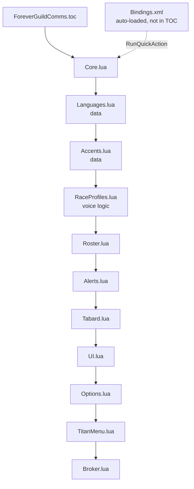
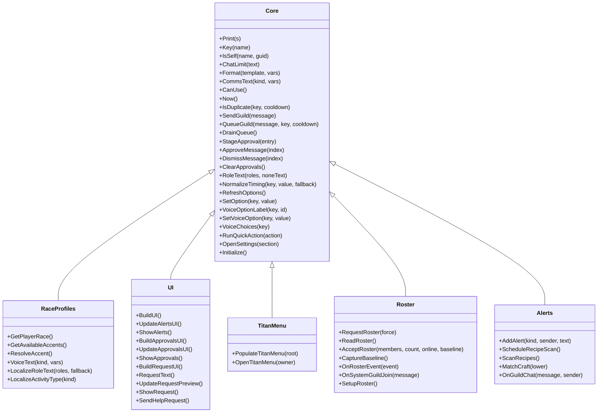

# Code Structure

**Analysis target**: Forever Guild Comms **0.4.3-beta**
**Supersedes**: the 0.4.1-beta pass of 2026-10-19T02:40:00Z

## Build System

- **Type**: still none for the addon itself. No transpiler, no bundler, no dependency
  manager. The `.lua` files and `Bindings.xml` are the shipped artifact and the client's
  embedded Lua 5.1 interpreter is the only runtime.
- **Added since 0.2.0**: a release pipeline that packages but does not compile.
  `.github/workflows/package.yml` (30 lines) invokes BigWigsMods/packager on a `v*` tag;
  `.pkgmeta` (13 lines) controls what the release archive contains.

```
## Interface: 16001
## Title: Forever Guild Comms
## Notes: Welcomes, guild greetings, translated and RP-accented messages, levels, crafting and LFG alerts, tabard reminders, and group requests.
## Author: Michael Reilly
## IconTexture: Interface\AddOns\ForeverGuildComms\Media\Icon
## Version: 0.4.3-beta
## SavedVariables: ForeverGuildCommsDB
## SavedVariablesPerCharacter: ForeverGuildCommsCharDB
## OptionalDeps: Titan
Core.lua
Languages.lua
Accents.lua
RaceProfiles.lua
MessageVariants.lua
Roster.lua
Alerts.lua
Tabard.lua
UI.lua
Options.lua
TitanMenu.lua
Broker.lua
```

Two TOC changes this span: the version and the `MessageVariants.lua` entry, inserted after
`RaceProfiles.lua` and before `Roster.lua`.

**Load-order constraints, now four.** The four data and voice modules sit between
`Core.lua` and `Roster.lua`:

1. `Languages.lua` must follow `Core.lua` — it reads `A.defaults.templates` at load time to
   populate its English entry.
2. `RaceProfiles.lua` must follow `Accents.lua` and `Languages.lua` — it indexes their
   tables.
3. `MessageVariants.lua` must load before the first message is composed. Its placement
   after `RaceProfiles.lua` is natural but not strictly required, since
   `A:ChooseMessageTemplate` is reached through an existence check and receives the base
   template and resolved accent as arguments rather than reading the other data tables.
4. `Roster.lua` and `UI.lua` must follow the voice modules so `A:CommsText` resolves to the
   full pipeline rather than the plain-`Format` fallback.

The current order satisfies all four. `tests/syntax.lua` was updated in the same change to
include the new module, so a missing TOC entry and a missing compile check cannot drift
apart unnoticed.

- **Version coupling check**: all three locations agree at `0.4.3-beta` — TOC line 6,
  `Core.lua` line 9, `README.md` line 1. The three-place rule is upheld.
- **Interface number**: still `16001`.
- **Not in the TOC, by requirement**: `Bindings.xml`. The client auto-loads it from the
  addon root, and listing it would be wrong. Both distribution paths handle it explicitly:
  the installer appends it outside the TOC scan and fails if absent, and `.pkgmeta` does
  not exclude it.

## Module Hierarchy



### Text Alternative

```
Load order (order matters):
   1. Core.lua           <- creates shared table A, must be first
   2. Languages.lua      <- reads A.defaults.templates at load
   3. Accents.lua        <- pure data
   4. RaceProfiles.lua   <- reads A.accents, provides VoiceText
   5. Roster.lua         <- calls A:CommsText
   6. Alerts.lua
   7. Tabard.lua
   8. UI.lua
   9. Options.lua
  10. TitanMenu.lua
  11. Broker.lua

Shipped but not listed:
      Bindings.xml       <- auto-loaded by the client from the addon root

Not shipped (nine offline harnesses):
      tests/syntax.lua smoke.lua verify.lua settings.lua timing.lua
      tests/titanmenu.lua voice.lua keybindings.lua icon.lua
```

## Existing Files Inventory

| Path | Purpose | Lines | Since 0.4.1 |
| --- | --- | --- | --- |
| `ForeverGuildComms.toc` | Manifest: interface, metadata, icon texture, SavedVariables, optional dep, 12-file load order | 16 | +1 |
| `Core.lua` | Namespace, defaults, migrations, identity helpers, `ChatLimit`, `CommsText`, send queue, approval backlog, `SetOption`/`SetVoiceOption`, `NormalizeTiming`, `PruneEventsSeen`, `RunQuickAction`, binding labels, slash commands, the single 14-event frame | 505 | **+29** |
| `Languages.lua` | 8 languages, `localeTemplates`, `localeRoleNames`, `localeActivityTypes`. Zero methods | 81 | +0 |
| `Accents.lua` | 29 curated styles via a local `register` helper, plus `accentOrder`. Zero methods | 51 | +0 |
| `RaceProfiles.lua` | `raceAccents`, `GetPlayerRace`, `GetAvailableAccents`, `ResolveAccent`, `VoiceText`, `LocalizeRoleText`, `LocalizeActivityType` | 109 | **+7** |
| `MessageVariants.lua` | `localeVariants` (68), `accentVariants` (136), `messageVariantBags`, `ChooseMessageTemplate` | 229 | **new** |
| `Roster.lua` | Roster read, baseline, diff, guild-join parsing. Emits through `CommsText` | 123 | +0 |
| `Alerts.lua` | Chat parsing, craft and group detection, recipe cache | 99 | +0 |
| `Tabard.lua` | City detection, tabard check, two popups. Login-ordering fix and per-stay prompt dedup | 70 | **+6** |
| `UI.lua` | Alerts inbox, review window, Ask-for-Help composer with fingerprinted draft caching | 302 | **+16** |
| `Options.lua` | Settings canvas: toggles incl. `randomizeMessages`, mode radios, timing fields, template editors, languages and accents, non-consuming preview, scroll anchors | 287 | **+1** |
| `TitanMenu.lua` | `PopulateTitanMenu`, `OpenTitanMenu` via Blizzard `MenuUtil` | 128 | **+1** |
| `Broker.lua` | LibDataBroker object, counts, click routing | 38 | +0 |
| `Bindings.xml` | Three opt-in hotkeys dispatching to `RunQuickAction` | 12 | +0 |
| `tests/syntax.lua` | Compiles all 12 shipped modules | 6 | +0 (list updated) |
| `tests/smoke.lua` | Roster diff, guild-join, chat parsing, recipe cache | 75 | +0 |
| `tests/verify.lua` | Approval workflow, mode switching, guild-change safety | 69 | +0 |
| `tests/settings.lua` | SavedVariables migration, options widgets | 87 | +0 |
| `tests/timing.lua` | Queue delay arithmetic, login cooldown, zero cooldown | 55 | +0 |
| `tests/titanmenu.lua` | LDB object plus the whole nested menu tree | 168 | +0 |
| `tests/voice.lua` | Languages, accent filtering, custom-template precedence, UTF-8 | 46 | +0 |
| `tests/keybindings.lua` | Executes the real XML handlers; asserts opt-in and no-send | 62 | +0 |
| `tests/icon.lua` | Icon wiring across TOC, Broker, Options, installer, and the two textures | 21 | +0 |
| `tests/tabard_dedup.lua` | The login-ordering race, per-stay prompt dedup, city exit/re-entry, and the full dedup-cache lifecycle | 117 | **new** |
| `tests/variations.lua` | Shuffle bags across every language and accent, variant completeness, custom override, non-consuming preview, preview/send stability | 93 | **new** |
| `README.md` | Install, keybindings, features, commands, modes, templates, limitations, test sequence, 0.4.3 maintenance notes | 169 | **+11** |
| `PACKAGING.md` | Release packaging process | 113 | version refs |
| `.pkgmeta` | Packager config and release exclusions | 13 | +0 |
| `.github/workflows/package.yml` | Tag-triggered release packaging | 30 | +0 |
| `install/Install-ForeverGuildComms.ps1` | TOC-driven Windows installer with backup | 313 | version ref |
| `install/Install-ForeverGuildComms.cmd` | Double-click launcher | 31 | version refs |
| `install/INSTALL-README.txt` | End-user install instructions | 66 | version ref |
| `.gitattributes` | LF line-ending policy | 21 | +0 |
| `.gitignore` | Packager build output, local ZIPs, editor temp files | 9 | +0 |
| `LICENSE` | Licence text | 21 | +0 |
| `Media/Icon.tga` | In-game addon list icon | 64 KB | +0 |
| `Media/ProjectIcon.png` | Distribution listing icon | 481 KB | +0 |

**Shipped Lua**: 2,022 lines across 12 modules, up from 1,733 across 11 (+17%).
**Shipped non-Lua**: `Bindings.xml` 12 lines, two textures.
**Offline harnesses**: 799 lines across 11 files, up from 589 across 9 (+36%).

Test code is now **40% of shipped Lua** by line count, up from 34% at 0.4.1, 19% at 0.2.0,
and 8% at 0.1.0. For the first time **every module is loaded by at least one harness**.

## Key Modules and Their Public Surface

**64 `function A:` definitions**, up from 62. By module: Core 27, UI 11, Roster 7,
RaceProfiles 6, Alerts 5, Broker 2, Tabard 2, TitanMenu 2, Options 1, MessageVariants 1.
`Languages.lua` and `Accents.lua` define none — they are pure data.

The two additions are `A:PruneEventsSeen` (`Core.lua`) and `A:ChooseMessageTemplate`
(`MessageVariants.lua`). Two signatures widened: `A:CommsText(kind, vars, preview)` and
`A:VoiceText(kind, vars, preview)`.

**16 `local function` definitions**, unchanged. `MessageVariants.lua` declares none: unlike
`Accents.lua`, which funnels its 29 entries through a local `register` helper, the variant
tables are written as plain literals.



All modules attach to the same table `A`, so this is a composition view, not inheritance.

## State Declared on the Shared Table

New and changed entries marked.

| State | Initial value | Declared in | Meaning |
| --- | --- | --- | --- |
| `A.version` | `"0.4.1-beta"` | Core | **Changed** |
| `A.voiceDefaults` | `{language="en", accent="none", raceFilter=true, accentStrength="subtle"}` | Core | **New.** Per-character voice defaults |
| `A.timingLimits` | `{messageSpacing={3,120}, loginCooldown={0,3600}}` | Core | **New.** Clamp ranges |
| `A.defaults` | table | Core | 12 keys plus 4 templates |
| `A.languages` / `A.languageByID` | 8 entries | Languages | **New** |
| `A.localeTemplates` | 8 locales x 4 templates | Languages | **New** |
| `A.localeRoleNames` / `A.localeActivityTypes` | 8 locales | Languages | **New** |
| `A.accents` / `A.accentOrder` | 29 styles | Accents | **New** |
| `A.raceAccents` | 13 race keys | RaceProfiles | **New** |
| `A.char.voice` | backfilled in `Initialize` | Core | **New.** Per-character voice selections |
| `A.optionsPanel` | set in `BuildOptions` | Options | **New.** Lets `RefreshOptions` find the panel |
| `A.optionsScroll` | set in `BuildOptions` | Options | **New.** Deep-link scrolling |
| `A.messagesScrollY` / `A.languagesScrollY` | set in `BuildOptions` | Options | **New.** Section anchors |
| `A.pendingApprovals` | `{}` | Core | Approval backlog, capped at 30 |
| `A.pendingMessages` | `{}` | Core | Spacing queue, holds entry records |
| `A.eventsSeen` | `{}` | Core | Cooldown keys, still never pruned |
| `A.alerts` | `{}` | Core | Private alerts, newest first, capped at 30 |
| `A.classRoles` / `roleNames` / `roleOrder` | tables | Core | Role model |
| `A.onlineCount` / `guildCount` / `lastGuildSend` | `0` | Core | Counters |
| `A.db` / `A.char` | set in `Initialize` | Core | SavedVariables handles |
| `A.playerGuid` / `playerName` / `playerKey` / `selfKeys` / `playerClass` | set in `Initialize` | Core | Self-identity |
| `A.initialized` / `A.queueTimer` | booleans | Core | Gates and latches |
| `A.roster` / `rosterReady` / `rosterGuild` / `baselineTimer` / `lastRosterRequest` | - | Roster | Roster state |
| `A.recipeScanPending` | boolean | Alerts | Scan latch |
| `A.wasInCity` / `A.tabardCheckScheduled` | - | Tabard | Tabard state |
| `A.alertFrame` / `alertRows` / `alertPage` / `alertPageText` / `reviewShortcut` | set in `BuildUI` | UI | Alerts window |
| `A.approvalFrame` / `approvalRows` / `approvalPage` / `approvalPageText` / `approvalEmpty` | set in `BuildApprovalsUI` | UI | Review window |
| `A.requestFrame` / `activityEdit` / `roleChecks` / `needChecks` / `requestPreview` / `GetActivityType` | set in `BuildRequestUI` | UI | Composer |
| `A.lastManualRequest` | `nil` | UI | 20s manual send limit |
| `A.settingsCategory` | set in `BuildOptions` | Options | Category handle |
| `A.broker` | `nil` | Broker | LDB object |
| ~~`A.lastMessages`~~ | - | - | **Removed in 0.3.0.** Was dead state flagged in both prior passes |

### Global namespace

`_G.ForeverGuildComms`, `SLASH_FOREVERGUILDCOMMS1`, `SLASH_FOREVERGUILDCOMMS2`,
`SlashCmdList.FOREVERGUILDCOMMS`, four named frames
(`ForeverGuildCommsOptionsPanel`, `FGCAlertsFrame`, `FGCRequestFrame`,
`FGCApprovalsFrame`), two popup keys, and **four new `BINDING_*` globals**
(`BINDING_HEADER_FOREVERGUILDCOMMS` plus three `BINDING_NAME_*`). The binding globals are
required by the client's Key Bindings UI and have no alternative.

## Design Patterns

### Carried forward and intact
Shared-namespace modules; single event dispatcher; guarded cross-file dispatch; debounce
via timer plus boolean latch; queue with cooldown keys; defaults backfill; widget factory
closures; row pooling with paging; two-phase identity normalization; pattern escaping for
localized globals; late-bound delivery decision; identity-bound message records;
asymmetric mode transitions; fail-safe setting normalization; single validating setter per
scope; pure data modules; optional layer behind an indirection; customized content wins;
encoding-aware truncation; self-healing dependent selections; declarative input with one
dispatcher; deep-linking into a deferred panel; harness with a synthetic widget layer.

### Shuffle bag with cross-bag memory *(new in 0.4.2)*
- **Location**: `A:ChooseMessageTemplate` in `MessageVariants.lua`.
- **Purpose**: vary wording without the randomness feeling repetitive or clustered.
- **Implementation**: candidates are the base template plus any curated additions that are
  non-empty and not equal to the base. With fewer than two candidates it returns the base
  unchanged. Otherwise a bag keyed `kind:language:accentId` holds a Fisher-Yates-shuffled
  index order and a position; each draw advances the position, and exhaustion reshuffles.
  The subtle part is `bag.last`: on reshuffle, if the new order would open with the same
  index the previous bag closed on, the first two entries are swapped. So "exhaust before
  repeating" holds *within* a bag and "never twice in a row" holds *across* bag
  boundaries. The bag also invalidates itself if the candidate count changes, which happens
  when the player switches language or accent.

### Fingerprinted draft cache *(new in 0.4.2)*
- **Location**: `A:RequestText` in `UI.lua`.
- **Purpose**: once wording varies, a redraw could otherwise change the message between
  what the user read and what the Send button posts.
- **Implementation**: a `\031`-joined fingerprint over the help template, the randomize
  flag, all four voice settings, and all five interpolated values. If the fingerprint
  matches the cached draft, the cached text is returned verbatim; otherwise a fresh draft
  is composed. `ShowRequest` clears the draft so each opening gets a new wording, and
  `SendHelpRequest` clears it after a successful send. The comment states the requirement
  directly: the Send button must send exactly the wording shown in the preview.

### Non-consuming preview *(new in 0.4.2)*
- **Location**: the `preview` parameter threaded through `A:CommsText` and `A:VoiceText`.
- **Purpose**: the Settings page renders a sample greeting on every refresh; without this
  it would silently advance the shuffle bag.
- **Implementation**: `Options.lua` passes `true`, and `VoiceText` skips variant selection
  when it is set. `tests/variations.lua` asserts the bag table stays empty after a preview
  call.

### Bounded cache with a two-source sweep *(new in 0.4.3)*
- **Location**: `A:PruneEventsSeen`, called from `A:IsDuplicate` and from a ticker.
- **Purpose**: `A.eventsSeen` grew for the life of a session.
- **Implementation**: two triggers cover both regimes — an activity-driven sweep inside
  `IsDuplicate`, self-throttled to once per 60 seconds so a busy guild does not pay for a
  full table walk per message, and a 300-second `C_Timer.NewTicker` registered in
  `Initialize` so a quiet session still drains. Retention is
  `timingLimits.loginCooldown.max`, chosen deliberately over the configured cooldown:
  the comment notes a shorter window would re-admit a suppressed event if the user later
  raised `loginCooldown`. The sweep also drops non-numeric and future-dated values, and
  `IsDuplicate` gained a `now >= seenAt` guard, both hardening against a `GetTime`
  discontinuity across a reload.

### Single validating setter *(new in 0.3.0)*
- **Location**: `A:SetOption`, and `A:SetVoiceOption` for the per-character scope.
- **Purpose**: two independent configuration UIs cannot drift or bypass validation.
- **Implementation**: dispatch on the key's kind — enum keys check membership, timing keys
  pass through `NormalizeTiming`, boolean keys require a boolean, and anything else is
  refused. A `changed` flag avoids redundant refreshes, and the refresh fans out to
  `RefreshOptions` and `UpdateBroker`. `Options.lua` and `TitanMenu.lua` both write only
  here.

### Pure data modules *(new in 0.4.0)*
- **Location**: `Languages.lua`, `Accents.lua`.
- **Purpose**: separate curated content from the logic that selects it, so adding a
  language or style is a data edit with no code change.
- **Implementation**: both define zero methods. `Accents.lua` uses a file-local `register`
  helper to keep 29 entries declarative and uniform, with `accentOrder` giving stable
  presentation independent of table iteration order.

### Optional layer behind an indirection *(new in 0.4.0)*
- **Location**: `A:CommsText`.
- **Purpose**: make the whole voice feature removable without touching callers.
- **Implementation**: `if self.VoiceText then return self:VoiceText(...) end` then fall
  back to `Format(self.db.templates[kind], vars)`. The comment states the intent: existing
  tests and stripped-down installs still work. `tests/keybindings.lua` exercises exactly
  that path by loading only `Core.lua` and `Alerts.lua`.

### Customized content wins *(new in 0.4.0)*
- **Location**: `A:VoiceText`, mirrored by the `custom` flag in `A:RequestText`.
- **Purpose**: never rewrite text a human authored.
- **Implementation**: compare the stored template against `A.defaults.templates[kind]`; if
  they differ, format verbatim and return. This is why an item link or colour code in a
  custom template survives untouched, and `tests/voice.lua` asserts it with a real
  hyperlink.

### Encoding-aware truncation *(new in 0.4.0)*
- **Location**: `A:ChatLimit`, used by `Format`, `SendGuild`, and the `QueueGuild` entry
  builder.
- **Purpose**: translations introduced multibyte characters that a naive `sub(1, 250)`
  would split, producing mojibake at the limit.
- **Implementation**: walk backwards from byte 251 while the byte is a UTF-8 continuation
  byte (`>= 128 and < 192`), then cut. Asserted by a dedicated regression test.

### Self-healing dependent selections *(new in 0.4.0)*
- **Location**: `A:SetVoiceOption`, and the voice block of `A:Initialize`.
- **Purpose**: a stored accent can become invalid when the language or race filter changes.
- **Implementation**: after a `language` or `raceFilter` write, re-list the available
  accents and revert to `auto` if the current choice is absent. The comment is explicit
  that reverting beats using an incompatible style invisibly.

### Declarative input with a single dispatcher *(new in 0.4.1)*
- **Location**: `Bindings.xml` plus `A:RunQuickAction`.
- **Purpose**: add an input surface without duplicating action logic.
- **Implementation**: each XML body is a one-line guarded call into the dispatcher, which
  gates on `A.initialized` and handles three named actions. `TitanMenu.lua` was refactored
  onto the same dispatcher in the same change, removing the inline duplicate it had.

### Deep-linking into a deferred panel *(new in 0.3.0, extended in 0.4.0)*
- **Location**: `A:OpenSettings(section)`.
- **Purpose**: let a menu shortcut land on the right part of a long scrolling panel.
- **Implementation**: open the category, then `C_Timer.After(0, ...)` to defer the scroll
  until the scroll child exists, using anchors published by `Options.lua`. The comment
  notes the asynchronous display is the reason for the deferral.

### Harness with a synthetic widget layer *(extended)*
- **Location**: `tests/settings.lua` and `tests/titanmenu.lua`.
- **Purpose**: load frame-dependent modules offline.
- **Implementation**: a metatable whose `__index` returns real implementations for the few
  methods under test and a no-op otherwise, with `CreateFrame` recording every widget.
  `tests/titanmenu.lua` extends the idea to the menu API itself, building a fake node type
  with `CreateTitle`, `CreateButton`, `CreateCheckbox`, `CreateRadio`, and `CreateDivider`
  that records children, so the menu tree can be walked and its callbacks invoked.

## Critical Dependencies

### WoW Forever client API (1.60.1, Interface 16001)
- **Usage**: every external call, written against the modern namespaced surface.
- **New call sites in this span**: `MenuUtil.CreateContextMenu` (feature-detected, with a
  Settings fallback), `UnitRace`, `UIRadioButtonTemplate`, and the `BINDING_*` /
  `Bindings.xml` key-binding mechanism.
- **Purpose**: the entire runtime. Every call remains feature-detected because the client
  is in beta.

### LibDataBroker-1.1 via LibStub
- **Usage**: `Broker.lua` only, `LibStub("LibDataBroker-1.1", true)`.
- Still optional, still runtime-detected, still not embedded, still no version assertion.
- **Worth noting**: `TitanMenu.lua` did **not** add a Titan dependency. It uses Blizzard's
  `MenuUtil`, so no Titan menu library is bundled and the no-hard-dependency policy holds.

### BigWigsMods/packager *(new, release-time only)*
- **Version**: `@v2` action pin.
- **Usage**: `.github/workflows/package.yml`, on a `v*` tag.
- **Purpose**: build and attach the release ZIP. Not a runtime dependency.

### Standalone Lua 5.1 interpreter (development only)
- **Usage**: running the nine harnesses from the addon root.
- **Purpose**: offline verification. LuaJIT 2.1 works but is a superset; Lua 5.4 is
  unsuitable.
