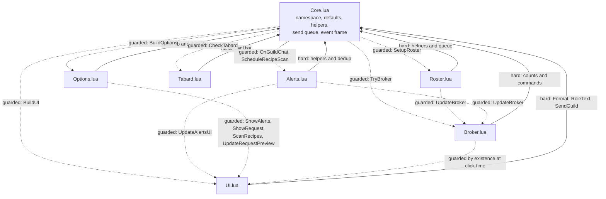

# Dependencies

## Internal Dependencies

The project is one package, so "internal dependencies" means the module dependency graph
within it. Load order is declared by the TOC and is significant.



Solid arrows are hard dependencies: the module cannot function without the target.
Dashed arrows are guarded calls made through an existence check, so a missing target
degrades the feature rather than raising an error.

### Text Alternative

```
Hard (upward) dependencies - every feature module depends on Core:
    Roster.lua  -> Core.lua
    Alerts.lua  -> Core.lua
    Tabard.lua  -> Core.lua
    UI.lua      -> Core.lua
    Options.lua -> Core.lua
    Broker.lua  -> Core.lua

Guarded (downward and sideways) calls - optional at runtime:
    Core.lua    -> Options, UI, Roster, Tabard, Broker, Alerts
    Roster.lua  -> Broker
    Alerts.lua  -> UI, Broker
    Options.lua -> UI, Alerts
    Broker.lua  -> UI, Core
```

### Dependency details

#### `Roster.lua` depends on `Core.lua`
- **Type**: Runtime, load-order-enforced
- **Reason**: Uses `A:Key`, `A:IsSelf`, `A:Format`, `A:CanUse`, `A:Now`, and
  `A:QueueGuild`. It also reads and writes shared state declared in `Core.lua`
  (`A.pendingMessages`, `A.guildCount`, `A.onlineCount`, `A.db`). It cannot produce any
  message without the queue.

#### `Alerts.lua` depends on `Core.lua`
- **Type**: Runtime, load-order-enforced
- **Reason**: Uses `A:Key`, `A:IsSelf`, `A:CanUse`, `A:IsDuplicate`, and `A:Print`, and
  writes `A.alerts` and `A.char.recipes`.

#### `Tabard.lua` depends on `Core.lua`
- **Type**: Runtime, load-order-enforced
- **Reason**: Uses `A:CanUse` and reads `A.db.tabardInCity` / `A.db.tabardOnExit`. The
  lightest coupling of the feature modules: no queue, no identity helpers.

#### `UI.lua` depends on `Core.lua`
- **Type**: Runtime, load-order-enforced
- **Reason**: Uses `A:Format`, `A:RoleText`, `A:CanUse`, `A:Now`, `A:Print`, and
  `A:SendGuild`, and reads `A.alerts`, `A.classRoles`, `A.roleOrder`, `A.roleNames`,
  `A.char.myRoles`, `A.char.needRoles`, `A.playerClass`, `A.playerName`, and
  `A.db.templates.help`.

#### `Options.lua` depends on `Core.lua`
- **Type**: Runtime, load-order-enforced
- **Reason**: Reads and writes `A.db` and every key in `A.defaults`. Also calls
  `A:ShowAlerts`, `A:ShowRequest`, `A:ScanRecipes`, and `A:UpdateRequestPreview` from its
  quick-action buttons; because it loads after `UI.lua` and `Alerts.lua`, those targets
  exist in practice, and `UpdateRequestPreview` is additionally guarded.

#### `Broker.lua` depends on `Core.lua`
- **Type**: Runtime, load-order-enforced
- **Reason**: Reads `A.onlineCount`, `A.guildCount`, and `A.alerts` for its label and
  tooltip, and calls `A:OpenSettings`, `A:ShowRequest`, and `A:ShowAlerts` from its click
  handler.

#### `Core.lua` depends on nothing internal
- **Type**: None
- **Reason**: It only reaches later modules through existence checks in `A:Initialize`
  and the event handler. This is what makes every other file optional from its point of
  view, and what allows `tests/smoke.lua` to load three modules in isolation.

#### `tests/smoke.lua` depends on `Core.lua`, `Roster.lua`, `Alerts.lua`
- **Type**: Test only, not shipped
- **Reason**: `loadfile(base .. "Core.lua")("ForeverGuildComms", A)` and the same for the
  other two. The remaining four modules are not loadable offline because they require
  real frame, Settings, popup, and LibStub APIs.

### Load order constraint

`Core.lua` must be listed first in the TOC. The other six could in principle load in any
order relative to each other, since all cross-module calls are either guarded or happen
after `PLAYER_LOGIN`. Two soft couplings nonetheless depend on the current order:

- `Options.lua` loads after `UI.lua` and `Alerts.lua`, so its quick-action buttons bind to
  methods that already exist. Three of the four are unguarded.
- `UI.lua`'s `BuildRequestUI` reads `A.char.myRoles` and `A.playerClass`, both set in
  `A:Initialize` before `BuildUI` is called, so the ordering inside `Initialize` matters
  more than the TOC order here.

## External Dependencies

### WoW Forever client API
- **Version**: game 1.60.1, TOC interface `16001`
- **Purpose**: the entire runtime. Events, frames, timers, chat, roster, trade skill,
  map, inventory, settings, and persistence.
- **Dependency type**: Platform. Non-optional and non-substitutable.
- **License**: Proprietary (Blizzard Entertainment). Consumed as a host API, not
  redistributed.
- **Risk**: The client is in beta and Blizzard is still changing it. The codebase
  mitigates this by feature-detecting every API before calling it, including ones
  believed to exist, and by degrading with an `A:Print` note instead of erroring. The
  Forever default frames have already been reskinned and reorganized once, which is why
  the addon does not anchor to or restyle Blizzard's unit frames or minimap header.

### LibDataBroker-1.1
- **Version**: unpinned. Whatever copy Titan Panel supplies (Titan 9.3.5 includes one).
- **Purpose**: the optional status indicator in `Broker.lua`.
- **Dependency type**: **Optional, runtime-detected, not embedded.** Declared
  `## OptionalDeps: Titan` in the TOC, never `RequiredDeps`.
- **License**: LibDataBroker-1.1 is distributed under a permissive license by its authors;
  since no copy is vendored here, this project ships none of it and inherits no
  obligation.
- **Risk**: Low. The lookup uses the silent-failure form
  `LibStub("LibDataBroker-1.1", true)` followed by `if not lib then return end`, so the
  addon is fully functional with no broker present. No version is asserted, which means a
  future incompatible LDB revision would surface as a runtime error in the data object
  rather than a clean refusal — an accepted trade given the stability of the 1.1
  interface.

### LibStub
- **Version**: unpinned, supplied by whichever addon loaded it first.
- **Purpose**: the lookup mechanism for LibDataBroker.
- **Dependency type**: Optional, guarded by `LibStub and LibStub(...)`.
- **License**: public domain.
- **Risk**: Low, same mitigation as above.

### Standalone Lua 5.1 interpreter
- **Version**: 5.1.5 recommended
- **Purpose**: running `tests/smoke.lua` outside the game.
- **Dependency type**: Development only. Not shipped, not required to use the addon.
- **License**: MIT (Lua).
- **Risk**: Environmental. No Windows package manager carries 5.1.5, so it is installed
  manually from the LuaBinaries distribution, keeping `lua5.1.dll` and the bundled
  `Microsoft.VC80.CRT\` folder beside `lua5.1.exe`. LuaJIT 2.1 can substitute but is a
  superset, so test code must avoid `ffi`, `bit`, `jit`, `table.new`, and `goto`. Lua 5.4
  is explicitly unsuitable because of the integer/float split and the relocation of
  `unpack`. If no interpreter is available, the project's rule is to say so rather than
  report the suite as passing.

## Dependency Policy

Three constraints recorded in the project's own steering documents, all currently upheld
by the code:

1. **No hard library dependencies.** Titan and LibDataBroker are optional and detected at
   runtime; the addon must work fully without them.
2. **No embedded libraries.** Nothing is vendored. `.gitignore` additionally blocks
   compiled Lua, archives, object files, shared objects, and executables.
3. **No addon-to-addon comms.** `C_ChatInfo.SendAddonMessage` is not used and is a stated
   non-goal.

## Supply Chain Surface

Effectively zero. There is no package manager, no lockfile, no transitive dependency
tree, and no build-time code fetched from a registry. The only third-party code that can
enter the process is LibDataBroker, and only if the user has separately installed an
addon that provides it. This removes the usual typosquatting and dependency-confusion
risk entirely.
