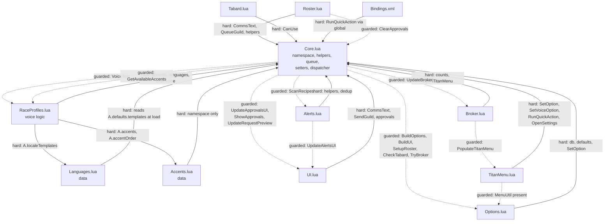

# Dependencies

**Analysis target**: Forever Guild Comms **0.4.3-beta**
**Supersedes**: the 0.4.1-beta pass of 2026-10-19T02:40:00Z

No runtime dependency was added, removed, or upgraded across 0.3.0 through 0.4.3. The
dependency policy and the supply chain surface are unchanged. The internal graph gained one
module this span.

### `MessageVariants.lua` — notably decoupled

It is the only data module that does **not** depend on the others. `Languages.lua` reads
`A.defaults.templates` at load, and `RaceProfiles.lua` indexes `A.accents`,
`A.accentOrder`, and `A.localeTemplates`. By contrast `A:ChooseMessageTemplate` receives
the base template and the already-resolved accent as arguments and reads only its own two
tables, so its only hard dependency is `Core.lua` for the namespace.

The call site in `RaceProfiles.lua` is guarded (`if ... and self.ChooseMessageTemplate`),
so the module is independently removable: strip it from the TOC and message wording simply
stops varying while everything else continues. That makes the voice feature a three-layer
stack where each layer above `Core.lua` can be dropped — translation, styling, and
variation — rather than one monolith.

## Internal Dependencies



Solid arrows are hard dependencies. Dashed arrows are guarded calls through an existence
check, so a missing target degrades the feature rather than raising an error.

### Text Alternative

```
Hard (upward) dependencies - everything depends on Core.lua:
    Languages.lua    -> Core.lua   (reads A.defaults.templates at LOAD time)
    Accents.lua      -> Core.lua   (namespace only)
    RaceProfiles.lua -> Core.lua, Accents.lua, Languages.lua
    Roster.lua       -> Core.lua
    Alerts.lua       -> Core.lua
    Tabard.lua       -> Core.lua
    UI.lua           -> Core.lua
    Options.lua      -> Core.lua
    TitanMenu.lua    -> Core.lua
    Broker.lua       -> Core.lua
    Bindings.xml     -> Core.lua   (via _G.ForeverGuildComms, guarded)

Guarded (downward) calls - optional at runtime:
    Core.lua   -> RaceProfiles (VoiceText, GetAvailableAccents)
    Core.lua   -> Options, UI, Roster, Tabard, Broker, Alerts
    Roster.lua -> Core.lua (ClearApprovals)
    Alerts.lua -> UI, Broker
    Broker.lua -> TitanMenu (PopulateTitanMenu), UI, Core
    TitanMenu  -> Options (fallback when MenuUtil is absent)
```

### New dependency details

#### `Languages.lua` depends on `Core.lua` **at load time**
- **Type**: Load-order-critical, not merely runtime.
- **Reason**: `A.localeTemplates.en = A.defaults.templates` executes while the file loads,
  so `A.defaults` must already exist. This is a stronger coupling than the other modules
  have, and it is why `Languages.lua` sits immediately after `Core.lua` in the TOC.

#### `RaceProfiles.lua` depends on `Accents.lua` and `Languages.lua`
- **Type**: Runtime, load-order-enforced.
- **Reason**: `GetAvailableAccents` iterates `A.accentOrder` and indexes `A.accents`;
  `VoiceText` indexes `A.localeTemplates`; `LocalizeRoleText` and
  `LocalizeActivityType` index `A.localeRoleNames` and `A.localeActivityTypes`. All three
  data tables must be populated first. The TOC order satisfies this.
- **Note**: the reads are defensive — `(self.localeTemplates or {})` and
  `(self.accentOrder or {})` — so a missing data module degrades to English defaults
  rather than erroring.

#### `Core.lua` now depends optionally on `RaceProfiles.lua`
- **Type**: Runtime, guarded.
- **Reason**: `A:CommsText` calls `A:VoiceText` when it exists, and the voice block of
  `A:Initialize` calls `A:GetAvailableAccents` behind `if self.GetAvailableAccents then`.
  This is the seam that makes the entire voice feature removable: strip the three modules
  from the TOC and `CommsText` falls back to plain `Format`.
- **Verified by test**: `tests/keybindings.lua` loads only `Core.lua` and `Alerts.lua` and
  still works, exercising exactly this fallback path.

#### `TitanMenu.lua` depends on `Core.lua`'s setters
- **Type**: Runtime, unguarded (safe — `Core.lua` always loads first).
- **Reason**: every menu control is bound to `A:SetOption` or `A:SetVoiceOption`, and the
  quick actions to `A:RunQuickAction`. The menu holds no settings logic of its own, which
  is the point: two UIs, one validator.

#### `Broker.lua` depends optionally on `TitanMenu.lua`
- **Type**: Runtime, guarded by load order and by `MenuUtil` detection inside
  `OpenTitanMenu`.
- **Reason**: the broker's right-click routes into the nested menu. `TitanMenu.lua` loads
  before `Broker.lua`, so the method exists; if the client lacks `MenuUtil`, the menu
  prints a note and opens Settings instead.

#### `Bindings.xml` depends on the global namespace
- **Type**: Runtime, guarded.
- **Reason**: each binding body is `if ForeverGuildComms then ForeverGuildComms:RunQuickAction(...) end`.
  The guard matters because the client may process a key press before the addon has
  published its namespace, and `RunQuickAction` itself adds a second gate on
  `A.initialized`.

### Load order constraints, consolidated

`Core.lua` must be first. Beyond that, three ordering requirements now exist where 0.2.0
had one:

1. `Languages.lua` after `Core.lua` — load-time read of `A.defaults.templates`.
2. `RaceProfiles.lua` after both `Accents.lua` and `Languages.lua` — needs their data.
3. `Roster.lua` and `UI.lua` after `RaceProfiles.lua` — so `A:CommsText` resolves to the
   voice path rather than silently falling back. Not an error if violated, but the feature
   would appear not to work.

Soft couplings that happen to hold: `Options.lua` loads after `UI.lua` and `Alerts.lua`,
so its quick-action buttons bind to existing methods; `Broker.lua` loads after
`TitanMenu.lua`.

### Test dependencies

| Harness | Loads | Notes |
| --- | --- | --- |
| `tests/syntax.lua` | all 11 modules | Compiles only; never executes |
| `tests/smoke.lua` | Core, Roster, Alerts | Stubs `QueueGuild` and `AddAlert` |
| `tests/verify.lua` | Core | Drives the real queue and backlog |
| `tests/settings.lua` | Core, Options | Synthetic widget layer |
| `tests/timing.lua` | Core, Languages, Accents, RaceProfiles | Loads the voice modules so `CommsText` takes the real path |
| `tests/titanmenu.lua` | Core, Options, TitanMenu, Broker | Synthetic widget and menu-node layers |
| `tests/voice.lua` | Core, Languages, Accents, RaceProfiles | The voice layer's dedicated harness |
| `tests/keybindings.lua` | Core, Alerts | Deliberately omits the voice modules, proving the `CommsText` fallback |
| `tests/icon.lua` | none | Reads the TOC, `Broker.lua`, `Options.lua`, the installer, and both textures as files |

**Offline testability, updated again.** The 0.1.0 pass recorded that only `Core.lua`,
`Roster.lua`, and `Alerts.lua` could load offline. The 0.2.0 pass corrected that to
include `Options.lua`. It is now broader still: `TitanMenu.lua` and `Broker.lua` are both
loaded and exercised by `tests/titanmenu.lua`, the three voice modules by `voice.lua` and
`timing.lua`, and `Bindings.xml` by `keybindings.lua`. **Only `Tabard.lua` has no harness
that loads it**, and `UI.lua` is loaded but its windows are stubbed rather than driven.
`.kiro/steering/testing.md` still asserts the original, narrower claim; see
`code-quality-assessment.md`.

## External Dependencies

### WoW Forever client API
- **Version**: game 1.60.1, TOC interface `16001`
- **Purpose**: the entire runtime.
- **Dependency type**: Platform. Non-optional, non-substitutable.
- **License**: Proprietary (Blizzard). Consumed as a host API, not redistributed.
- **New surfaces consumed this span**: `MenuUtil.CreateContextMenu`, `UnitRace`,
  `UIRadioButtonTemplate`, and the `Bindings.xml` / `BINDING_*` key-binding mechanism.
- **Risk**: the client is in beta and still changing. Mitigated as before by
  feature-detecting every call. `MenuUtil` is the clearest example: absent it, the menu
  degrades to the Settings page with a printed explanation. `UnitRace` is guarded and an
  unknown race yields only `auto` and `none`.

### LibDataBroker-1.1
- **Version**: unpinned; whatever Titan Panel supplies.
- **Purpose**: the optional status indicator.
- **Dependency type**: **Optional, runtime-detected, not embedded.** `## OptionalDeps: Titan`,
  never `RequiredDeps`.
- **License**: permissive; no copy is vendored here, so this project ships none of it.
- **Risk**: low. `LibStub("LibDataBroker-1.1", true)` plus an explicit nil guard. No
  version is asserted.
- **Worth recording**: the 0.3.0 nested menu was the obvious moment to take on a Titan
  menu-library dependency, and the project declined, using Blizzard's `MenuUtil` instead.
  `TitanMenu.lua`'s header comment states this explicitly. The no-hard-dependency policy
  survived a feature that would plausibly have broken it.

### LibStub
- **Version**: unpinned, supplied by whichever addon loaded it first.
- **Dependency type**: Optional, guarded by `LibStub and LibStub(...)`.
- **License**: public domain.

### BigWigsMods/packager **(new, release-time only)**
- **Version**: pinned to the `@v2` major tag.
- **Purpose**: builds and publishes the release ZIP from a `v*` tag.
- **Dependency type**: CI only. Not shipped, not required to build or run the addon.
- **License**: open source, used as a GitHub Action.
- **Risk**: low but non-zero. The `@v2` pin is a moving major tag rather than a commit
  SHA, so an upstream change within v2 would be picked up automatically. Standard practice
  for Actions, and the blast radius is a failed or malformed release rather than anything
  reaching users silently. The workflow also grants `contents: write`, which is the
  minimum needed to attach a release asset.

### actions/checkout **(new, release-time only)**
- **Version**: `@v4`, with `fetch-depth: 0` for tag and changelog access.
- **Dependency type**: CI only.

### Standalone Lua 5.1 interpreter
- **Version**: 5.1.5 recommended.
- **Purpose**: running the nine harnesses.
- **Dependency type**: Development only.
- **License**: MIT.
- **Risk**: environmental. Not installed on the current machine, so no harness was
  executed during this pass.

## Dependency Policy

Three constraints from the project's steering documents, all still upheld:

1. **No hard library dependencies.** Titan and LibDataBroker remain optional and
   runtime-detected. Actively tested this span and held.
2. **No embedded libraries.** Nothing vendored. `.gitignore` blocks packager output and
   local archives.
3. **No addon-to-addon comms.** `C_ChatInfo.SendAddonMessage` is still unused.

## Supply Chain Surface

Still near zero **at runtime**: no package manager, no lockfile, no transitive tree, and
no code fetched from a registry into the shipped addon. The only third-party code that can
enter the game process is LibDataBroker, and only if the user separately installed an
addon providing it.

A small **release-time** surface now exists: two pinned GitHub Actions
(`actions/checkout@v4`, `BigWigsMods/packager@v2`) run in CI with `contents: write`. Both
are major-tag pins rather than SHA pins. This is conventional and the exposure is limited
to the release artifact, but it is the first point at which third-party code participates
in producing what users download.
